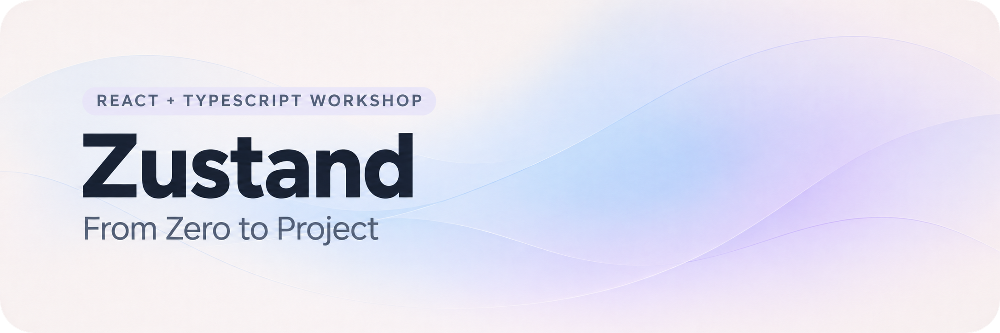
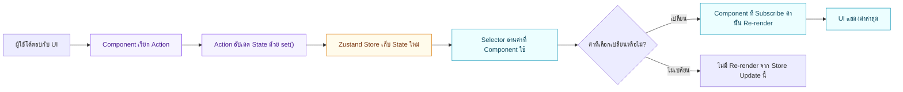

<div align="center">

  

  เรียนรู้การจัดการ State ด้วย Zustand ตั้งแต่พื้นฐาน  
  จนสามารถนำไปประยุกต์ใช้กับโปรเจกต์ React + TypeScript ได้จริง

  
  
  

</div>

---

## เกี่ยวกับ Workshop

Workshop นี้ออกแบบมาให้เรียน Zustand อย่างเป็นลำดับ โดยเริ่มจากแนวคิดพื้นฐาน เช่น **Store**, **State** และ **Action** ก่อนต่อยอดไปสู่การจัดการข้อมูลที่ซับซ้อน การเรียก API การบันทึกข้อมูล และระบบ Authentication

> **แนวทางการเรียน**  
> เรียนรู้แนวคิด → ดูตัวอย่าง → ทำความเข้าใจการทำงาน → ทดลองเขียน → ตรวจสอบผลลัพธ์

## สิ่งที่จะได้เรียนรู้

- สร้าง Store และ Action ด้วย Zustand
- กำหนด Type ให้ Store ด้วย TypeScript
- เลือก State ด้วย Selector และเข้าใจการ Re-render
- จัดการ Object และ Array ภายใน Store
- จัดการ Async Action, Loading และ Error
- บันทึก State ลง `localStorage` ด้วย Persist Middleware
- ออกแบบ Authentication Store และเชื่อม Server-side Session
- วางโครงสร้าง Store สำหรับโปรเจกต์จริง

## เริ่มต้นใช้งาน

### ความต้องการของระบบ

- [Node.js](https://nodejs.org/) เวอร์ชันที่รองรับ Vite 8
- [pnpm](https://pnpm.io/)

### ติดตั้งและรันโปรเจกต์

```bash
# ติดตั้ง dependencies
pnpm install

# เปิด development server
pnpm dev
```

จากนั้นเปิด URL ที่แสดงใน Terminal (โดยปกติคือ `http://localhost:5173`)

### คำสั่งที่ใช้บ่อย

| คำสั่ง | รายละเอียด |
| --- | --- |
| `pnpm dev` | เปิด Development Server |
| `pnpm build` | ตรวจ TypeScript และ Build สำหรับ Production |
| `pnpm lint` | ตรวจสอบคุณภาพโค้ดด้วย Oxlint |
| `pnpm preview` | Preview Production Build |

## Roadmap การเรียน Zustand

| Workshop | หัวข้อ | สิ่งที่จะได้ฝึก |
| :---: | --- | --- |
| [01](./src/workshops/workshop01-zustand_fundamentals/README.md) | **Zustand Fundamentals** | Store, State, Action และ `set` |
| [02](./src/workshops/workshop02-action_parameters/README.md) | **Action Parameters** | Parameters, TypeScript และการส่งค่าจาก Component |
| [03](./src/workshops/workshop03-selectors_re-render/README.md) | **Selectors & Re-render** | การเลือก State และควบคุมการ Re-render |
| [04](./src/workshops/workshop04-objects_arrays/README.md) | **Objects & Arrays** | เพิ่ม แก้ไข และลบข้อมูล Employee |
| [05](./src/workshops/workshop05-async_action_api/README.md) | **Async Actions & API** | เรียก API พร้อมจัดการ Loading และ Error |
| [06](./src/workshops/workshop06-persist/README.md) | **Persist Middleware** | จัดเก็บ State ใน `localStorage` |
| [07.1](./src/workshops/workshop07-01-authentication_store/README.md) | **Authentication Store** | Login, Logout และ Current User |
| [07.2.1](./src/workshops/workshop07-02a-express/README.md) | **Express Login API** | Server-side Session และ HttpOnly Cookie |
| [07.2.2](./src/workshops/workshop07-02b-restore_authentication_session/README.md) | **Restore Authentication** | ตรวจสอบ Session และกู้คืน User หลัง Refresh |
| [07.2.3](./src/workshops/workshop07-02c-logout_session_destruction/README.md) | **Logout & Session Destruction** | ทำลาย Session และลบ HttpOnly Cookie |
| [07.3.1](./src/workshops/workshop07-03a-protect_route/README.md) | **Protected Routes** | React Router, Route Guard และ Nested Routes |

## เริ่มต้นเรียน

เริ่มต้นเรียนได้ที่ **[Workshop 01: Zustand Fundamentals →](./src/workshops/workshop01-zustand_fundamentals/README.md)**

## โครงสร้างโปรเจกต์

```text
zustand-from-zero-to-project/
├── assets-repo/     # ไฟล์ประกอบเอกสาร Workshop
│   ├── images/      # ภาพประกอบ
│   ├── diagrams/    # ต้นฉบับ Mermaid
│   └── prompts/     # Prompt สำหรับสร้างภาพ
├── server/          # Express TypeScript Backend
│   └── src/
├── src/
│   ├── components/  # React Components
│   ├── pages/       # หน้าจอที่ใช้กับ Router
│   ├── routes/      # Route Guards
│   ├── services/    # API Services
│   ├── stores/      # Zustand Stores
│   ├── types/       # TypeScript Types
│   ├── workshops/   # เอกสาร Workshop ตามลำดับ
│   ├── App.tsx
│   └── main.tsx
├── package.json
└── vite.config.ts
```

`assets-repo` ใช้เก็บภาพและ Diagram สำหรับ README โดยแยกจาก Assets ของแอปใน `src/assets` ปัจจุบัน React ไม่ได้ Import ไฟล์จาก `assets-repo` จึงไม่เพิ่มขนาด Bundle หรือถูกคัดลอกไป `dist` ในการ Build

## แนวคิดสำคัญ



Zustand เหมาะกับ State ที่หลาย Components ต้องใช้ร่วมกัน ส่วน State ที่ใช้เฉพาะภายใน Component ยังสามารถใช้ `useState` ได้ตามปกติ

Diagram นี้แสดงการ Re-render จาก Store Update โดย Component ยังอาจ Re-render จากสาเหตุอื่น เช่น Local State หรือ Parent Component ได้

ไฟล์ประกอบหน้านี้: [ภาพปกพร้อมชื่อโปรเจกต์](./assets-repo/images/zustand-workshop-gradient-cover-v2.png) · [ต้นฉบับ Mermaid](./assets-repo/diagrams/zustand-workshop-state-flow.mmd)

---

<div align="center">
  เรียนทีละแนวคิด ทดลองด้วยตัวเอง และค่อย ๆ สร้างพื้นฐาน State Management ที่แข็งแรง
</div>
