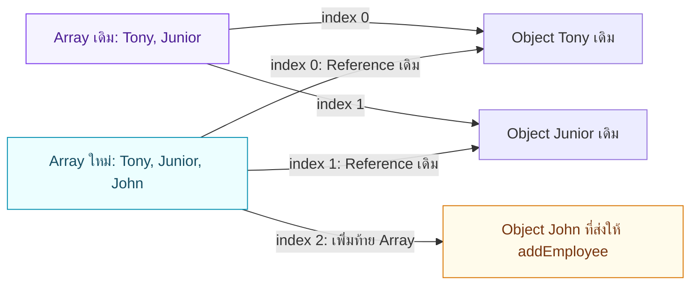
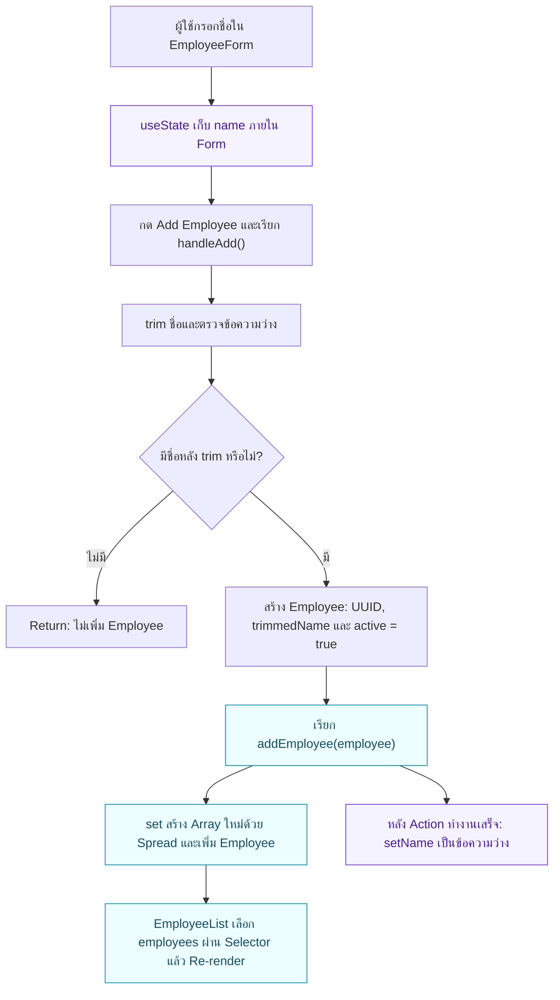
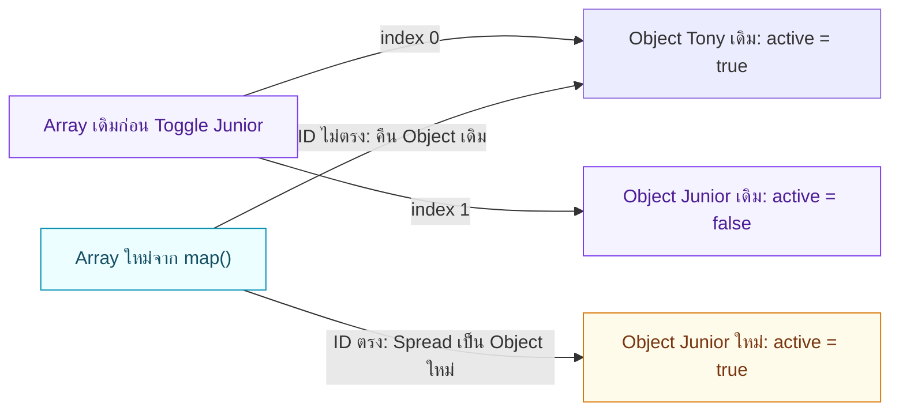

<div align="center">

  # Workshop 04: Objects & Arrays

  จัดการข้อมูลพนักงานด้วย Zustand + TypeScript  
  ตั้งแต่การเพิ่ม แสดง แก้ไขสถานะ ไปจนถึงการลบข้อมูล

  
  
  

  [← Workshop 03](../workshop03-selectors_re-render/README.md) · [หน้าหลัก](../../../README.md) · [Zustand Docs](https://zustand.docs.pmnd.rs/)

  <br />
  <br />

  

</div>

---

## เกี่ยวกับ Workshop

จาก Workshop 01–03 เราจัดการ State ที่เป็น `number` และ `string` มาแล้ว Workshop นี้จะยกระดับไปสู่ข้อมูลที่ใกล้เคียงกับโปรเจกต์จริงมากขึ้น ด้วยการสร้างระบบ **Employee Management** ขนาดเล็ก

ระบบที่เราจะสร้างสามารถ:

- แสดงรายชื่อพนักงาน
- เพิ่มพนักงานใหม่
- สลับสถานะ Active/Inactive
- ลบพนักงานออกจากรายการ

## เป้าหมายการเรียนรู้

เมื่อจบ Workshop นี้ คุณจะสามารถ:

- สร้าง Type สำหรับ Object ด้วย TypeScript Interface ได้
- จัดเก็บ Array of Objects ใน Zustand Store ได้
- เพิ่มข้อมูลโดยใช้ Spread Operator ได้
- ลบข้อมูลโดยใช้ `filter()` ได้
- แก้ไข Object ภายใน Array โดยใช้ `map()` ได้
- อัปเดต State แบบไม่แก้ไข Array หรือ Object เดิมโดยตรงได้
- แยก Local State และ Global State ตามหน้าที่ได้

## สารบัญ

1. [สร้าง Employee Type](#1-สร้าง-employee-type)
2. [สร้าง Zustand Store](#2-สร้าง-zustand-store)
3. [แสดงรายชื่อพนักงาน](#3-แสดงรายชื่อพนักงาน)
4. [สร้างฟอร์มเพิ่มพนักงาน](#4-สร้างฟอร์มเพิ่มพนักงาน)
5. [ทำความเข้าใจ Data Flow](#5-ทำความเข้าใจ-data-flow)
6. [Workshop Challenge](#6-workshop-challenge)
7. [คำถามทบทวน](#7-คำถามทบทวน)
8. [สิ่งที่ต้องส่งก่อนขึ้น Workshop 05](#สิ่งที่ต้องส่งก่อนขึ้น-workshop-05)

---

## 1. สร้าง Employee Type

เริ่มจากกำหนดโครงสร้างข้อมูลของพนักงานหนึ่งคนในไฟล์ `src/types/employee.ts`:

```ts
export interface Employee {
  id: string;
  name: string;
  active: boolean;
}
```

แต่ละ Property มีหน้าที่ดังนี้:

| Property | Type | ความหมาย |
| --- | --- | --- |
| `id` | `string` | รหัสที่ไม่ซ้ำกันของพนักงาน |
| `name` | `string` | ชื่อพนักงาน |
| `active` | `boolean` | สถานะการทำงาน |

### Object หนึ่งรายการ

```ts
const employee: Employee = {
  id: "emp001",
  name: "Tony",
  active: true,
};
```

### Array ที่มีหลายรายการ

```ts
const employees: Employee[] = [
  { id: "emp001", name: "Tony", active: true },
  { id: "emp002", name: "Junior", active: false },
];
```

> [!NOTE]
> `Employee` หมายถึง Object ของพนักงานหนึ่งคน ส่วน `Employee[]` หมายถึง Array ที่เก็บพนักงานหลายคน

## 2. สร้าง Zustand Store

สร้างไฟล์ `src/stores/useEmployeeStore.ts`:

```ts
import { create } from "zustand";
import type { Employee } from "../types/employee";

interface EmployeeStore {
  employees: Employee[];
  addEmployee: (employee: Employee) => void;
}

export const useEmployeeStore = create<EmployeeStore>()((set) => ({
  employees: [
    { id: "emp001", name: "Tony", active: true },
    { id: "emp002", name: "Junior", active: false },
  ],

  addEmployee: (employee) => {
    set((state) => ({
      employees: [...state.employees, employee],
    }));
  },
}));
```

Store นี้ประกอบด้วย:

| ชื่อ | ประเภท | หน้าที่ |
| --- | --- | --- |
| `employees` | State | เก็บ Array ของพนักงาน |
| `addEmployee` | Action | รับ Employee และเพิ่มเข้า Array |

### ทำความเข้าใจ addEmployee

```ts
addEmployee: (employee) => {
  set((state) => ({
    employees: [...state.employees, employee],
  }));
},
```

Spread Operator จะคัดลอกสมาชิกเดิมทั้งหมดและเพิ่ม Employee ใหม่ไว้ท้าย Array:



```ts
[...state.employees, employee]
```

Expression นี้สร้าง **Array ใหม่** โดยไม่แก้ไข Array เดิม

Spread คัดลอก Reference ของสมาชิกเดิม ไม่ได้ Clone Object ทุกตัว ดังนั้น Tony และ Junior ยังเป็น Object เดิม ส่วน John คือ Object ที่รับเข้ามาและเพิ่มไว้ท้าย Array ใหม่

### ทำไมไม่ใช้ push()?

```ts
// ❌ แก้ไข Array เดิมโดยตรง
state.employees.push(employee);

// ✅ สร้าง Array ใหม่
set((state) => ({
  employees: [...state.employees, employee],
}));
```

การสร้าง Array ใหม่ทำให้การเปลี่ยนแปลง State มี Reference ใหม่ ซึ่งช่วยให้ Zustand และ React ตรวจพบการอัปเดตได้อย่างถูกต้อง

> [!IMPORTANT]
> หลีกเลี่ยงการแก้ไข State เดิมโดยตรง เว้นแต่ใช้ Middleware ที่ออกแบบมาสำหรับ Mutable Syntax เช่น Immer

## 3. แสดงรายชื่อพนักงาน

สร้าง `src/components/EmployeeList.tsx`:

```tsx
import { useEmployeeStore } from "../stores/useEmployeeStore";

const EmployeeList = () => {
  const employees = useEmployeeStore((state) => state.employees);

  return (
    <div>
      <h2>Employees</h2>

      {employees.map((employee) => (
        <div key={employee.id}>
          <p>{employee.name}</p>
          <span>{employee.active ? "Active" : "Inactive"}</span>
        </div>
      ))}
    </div>
  );
};

export default EmployeeList;
```

### เลือก Array จาก Store

```tsx
const employees = useEmployeeStore((state) => state.employees);
```

Selector นี้คืน Array ที่เก็บอยู่ใน Store โดยตรง ไม่ได้สร้าง Array ใหม่ภายใน Selector จึงไม่จำเป็นต้องใช้ `useShallow`

### แสดงข้อมูลด้วย map()

```tsx
{employees.map((employee) => (
  <div key={employee.id}>
    <p>{employee.name}</p>
  </div>
))}
```

React ต้องการ `key` ที่ไม่ซ้ำกันเพื่อระบุว่าแต่ละ Element สอดคล้องกับข้อมูลรายการใด จึงควรใช้ `employee.id` แทนตำแหน่ง Index

## 4. สร้างฟอร์มเพิ่มพนักงาน

สร้าง `src/components/EmployeeForm.tsx`:

```tsx
import { useState } from "react";
import { useEmployeeStore } from "../stores/useEmployeeStore";

const EmployeeForm = () => {
  const [name, setName] = useState("");
  const addEmployee = useEmployeeStore((state) => state.addEmployee);

  const handleAdd = () => {
    const trimmedName = name.trim();

    if (!trimmedName) return;

    addEmployee({
      id: crypto.randomUUID(),
      name: trimmedName,
      active: true,
    });

    setName("");
  };

  return (
    <div>
      <input
        value={name}
        onChange={(event) => setName(event.target.value)}
        placeholder="Employee name"
      />

      <button onClick={handleAdd}>Add Employee</button>
    </div>
  );
};

export default EmployeeForm;
```

### Local State กับ Global State

Workshop นี้ยังใช้ `useState` ร่วมกับ Zustand เพราะ State ทั้งสองมีหน้าที่ต่างกัน:

| ข้อมูล | จัดเก็บด้วย | เหตุผล |
| --- | --- | --- |
| `name` ใน Input | `useState` | ข้อมูลชั่วคราว ใช้เฉพาะใน Form |
| `employees` | Zustand | หลาย Components ต้องอ่านหรือแก้ไขร่วมกัน |

> [!TIP]
> ไม่จำเป็นต้องย้ายทุก State ไปไว้ใน Zustand ให้เลือกที่เก็บตามขอบเขตการใช้งานของข้อมูล

### การสร้าง ID

```ts
id: crypto.randomUUID()
```

`crypto.randomUUID()` ใช้สร้าง UUID สำหรับการทดลองใน Browser ที่รองรับ Secure Context เช่น `localhost` ในระบบจริง ID มักถูกสร้างโดย Backend หรือ Database

## 5. ทำความเข้าใจ Data Flow

เมื่อผู้ใช้กรอกชื่อและกดปุ่ม **Add Employee** ข้อมูลจะไหลตามลำดับนี้:



นำ Components ไปประกอบใน `src/App.tsx`:

```tsx
import EmployeeForm from "./components/EmployeeForm";
import EmployeeList from "./components/EmployeeList";

export default function App() {
  return (
    <main>
      <EmployeeForm />
      <EmployeeList />
    </main>
  );
}
```

## 6. Workshop Challenge

ต่อยอดจากการเพิ่มข้อมูลด้วย Actions สำหรับลบและเปลี่ยนสถานะพนักงาน

### ภารกิจที่ต้องทำ

**ความคืบหน้า: 6/6**

- [x] สร้าง `Employee` Interface
- [x] สร้าง Employee Store และ `addEmployee`
- [x] สร้าง `EmployeeList`
- [x] สร้าง `EmployeeForm`
- [x] เพิ่ม `removeEmployee`
- [x] เพิ่ม `toggleEmployeeActive`

### Challenge A — ลบพนักงาน

เพิ่ม Action ชื่อ `removeEmployee` ซึ่งรับ `id: string` และลบพนักงานที่มี ID ตรงกันออกจาก Array

```ts
removeEmployee: (id: string) => void;
```

<details>
<summary><strong>เปิดคำใบ้ Challenge A</strong></summary>

ใช้ `filter()` เพื่อสร้าง Array ที่ไม่มี Employee ซึ่งมี ID ตรงกับค่าที่รับเข้ามา:

```ts
employees.filter((employee) => employee.id !== id)
```

`filter()` ไม่แก้ไข Array เดิม แต่คืน Array ใหม่ที่มีเฉพาะรายการซึ่งผ่านเงื่อนไข

</details>

### Challenge B — เปลี่ยนสถานะพนักงาน

เพิ่ม Action ชื่อ `toggleEmployeeActive` ซึ่งรับ `id: string` และสลับค่า `active` ของพนักงานคนนั้น

```ts
toggleEmployeeActive: (id: string) => void;
```

<details>
<summary><strong>เปิดคำใบ้ Challenge B</strong></summary>

ใช้ `map()` หา Employee ที่ ID ตรงกัน แล้วสร้าง Object ใหม่ด้วย Spread Operator:

```ts
employees.map((employee) =>
  employee.id === id
    ? { ...employee, active: !employee.active }
    : employee,
)
```

รายการที่ ID ไม่ตรงกันสามารถคืน Object เดิมได้ เพราะข้อมูลของรายการนั้นไม่ได้เปลี่ยน

</details>

### Reference ก่อนและหลัง Toggle

ตัวอย่างเมื่อ Toggle Junior จาก `active: false` เป็น `true` จะได้ Array ใหม่และ Object Junior ใหม่ ส่วน Tony ใช้ Reference เดิม:



Array และ Object เดิมยังคงค่าเดิมไว้ การใช้ Spread กับ Object ที่เปลี่ยนทำให้ไม่ต้องแก้ `employee.active` บน Object เดิมโดยตรง

### Challenge C — เชื่อม Actions กับ UI

เลือก Actions จาก Store และเรียกพร้อม `employee.id`:

```tsx
const toggleEmployeeActive = useEmployeeStore(
  (state) => state.toggleEmployeeActive,
);

const removeEmployee = useEmployeeStore(
  (state) => state.removeEmployee,
);
```

<details>
<summary><strong>เปิดคำใบ้ Challenge C</strong></summary>

```tsx
<button onClick={() => toggleEmployeeActive(employee.id)}>
  {employee.active ? "Active" : "Inactive"}
</button>

<button onClick={() => removeEmployee(employee.id)}>
  Remove
</button>
```

</details>

### รูปแบบการจัดการ Array ที่ควรจำ

| Operation | JavaScript Pattern | ผลลัพธ์ |
| --- | --- | --- |
| เพิ่มข้อมูล | `[...array, item]` | Array ใหม่ที่มี Item เพิ่มขึ้น |
| ลบข้อมูล | `filter()` | Array ใหม่ที่ไม่มี Item เป้าหมาย |
| แก้ไขข้อมูล | `map()` | Array ใหม่ที่มี Item บางรายการเปลี่ยน |

ทั้งสามแนวทางสร้าง Array ใหม่แทนการเปลี่ยน Array เดิมโดยตรง

ภาพเปิดบทและไฟล์ต้นฉบับ Diagram เก็บอยู่ใน `assets-repo`:

- [ภาพ Objects & Arrays](../../../assets-repo/images/workshop04-objects-arrays-hero.png)
- [Diagram: Array ใหม่และ Reference ของสมาชิก](../../../assets-repo/diagrams/workshop04-add-array-references.mmd)
- [Flowchart: Employee Form และ Store](../../../assets-repo/diagrams/workshop04-employee-data-flow.mmd)
- [Diagram: Object Reference ก่อนและหลัง Toggle](../../../assets-repo/diagrams/workshop04-toggle-object-references.mmd)

Mermaid จะแสดงเป็นแผนภาพบน GitHub และ Markdown Viewer ที่รองรับ ส่วนไฟล์ `.mmd` สามารถนำไปแก้ไขหรือ Export เป็นภาพต่อได้

## 7. คำถามทบทวน

### 1. ทำไม EmployeeForm ยังใช้ useState ทั้งที่มี Zustand แล้ว?

- A. เพราะ Zustand เก็บ `string` ไม่ได้
- B. เพราะชื่อใน Input เป็น Local State ที่ใช้เฉพาะภายใน Form
- C. เพราะ Zustand ใช้งานร่วมกับ Input ไม่ได้

<details>
<summary><strong>ดูคำตอบ</strong></summary>

**คำตอบ: B** — ค่าใน Input เป็นข้อมูลชั่วคราวที่ใช้เฉพาะใน Form จึงเหมาะกับ `useState` ส่วนรายการพนักงานเป็นข้อมูลที่หลาย Components ใช้ร่วมกันจึงเก็บใน Zustand

</details>

### 2. `[...state.employees, employee]` ทำงานอย่างไร?

- A. แก้ไข Array เดิมด้วยการเพิ่ม Employee
- B. สร้าง Array ใหม่จากข้อมูลเดิมและเพิ่ม Employee ไว้ท้าย Array
- C. แทนที่ Employee คนแรกใน Array

<details>
<summary><strong>ดูคำตอบ</strong></summary>

**คำตอบ: B** — Spread Operator คัดลอกสมาชิกจาก Array เดิมก่อนเพิ่ม Employee ใหม่เป็นสมาชิกลำดับสุดท้าย

</details>

### 3. หากต้องการลบ Employee ที่มี `id = "emp002"` ควรใช้วิธีใด?

- A. `map()` เพราะใช้วนข้อมูลใน Array
- B. `filter()` เพราะสร้าง Array ที่ตัดรายการเป้าหมายออกได้
- C. `push()` เพราะเปลี่ยนขนาดของ Array ได้

<details>
<summary><strong>ดูคำตอบ</strong></summary>

**คำตอบ: B** — `filter()` คืน Array ใหม่ที่มีเฉพาะ Employee ซึ่ง ID ไม่ตรงกับ `emp002`

</details>

## สิ่งที่ต้องส่งก่อนขึ้น Workshop 05

1. `employee.ts` — Type ของ Employee
2. `useEmployeeStore.ts` — Actions สำหรับเพิ่ม ลบ และเปลี่ยนสถานะ
3. `EmployeeForm.tsx` — Form เพิ่มพนักงาน
4. `EmployeeList.tsx` — รายการพนักงานพร้อมปุ่ม Toggle และ Remove
5. คำตอบของคำถามทบทวนทั้งสามข้อ

สิ่งที่จะตรวจ:

- การกำหนด Type ของ Object และ Array
- การอัปเดต State โดยไม่แก้ไขข้อมูลเดิมโดยตรง
- การเลือกใช้ Spread Operator, `filter()` และ `map()`
- การแบ่งหน้าที่ระหว่าง Local State กับ Zustand Store
- การส่ง ID จาก Component ไปยัง Action

---

<div align="center">

  **ถัดไป:** [Workshop 05 — Async Actions & API](../workshop05-async_action_api/README.md)

  [← Workshop 03](../workshop03-selectors_re-render/README.md) · [กลับสู่หน้าหลัก](../../../README.md)

</div>
