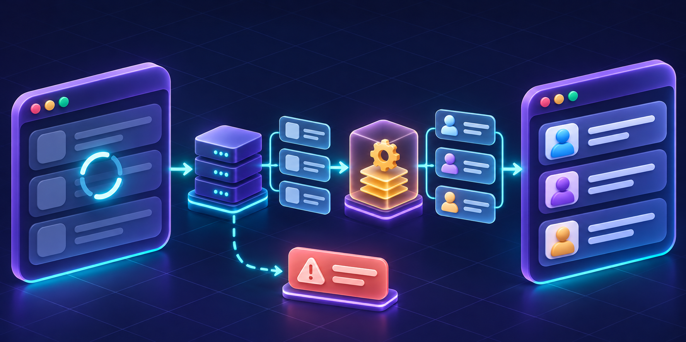
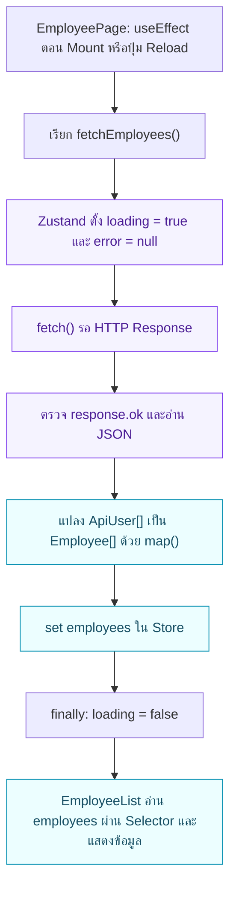
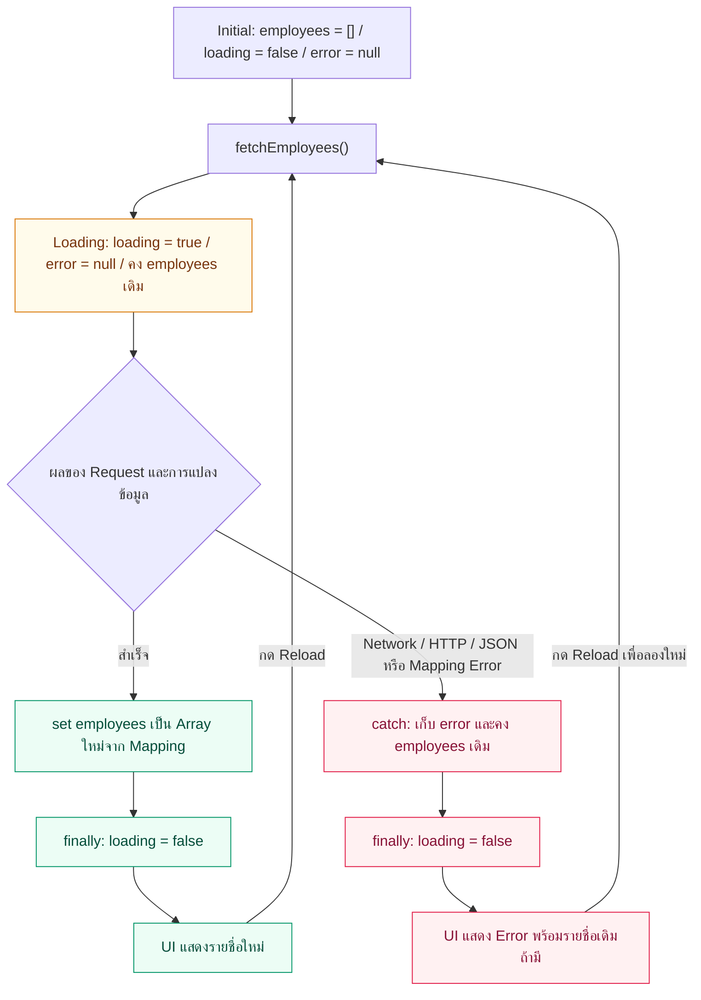
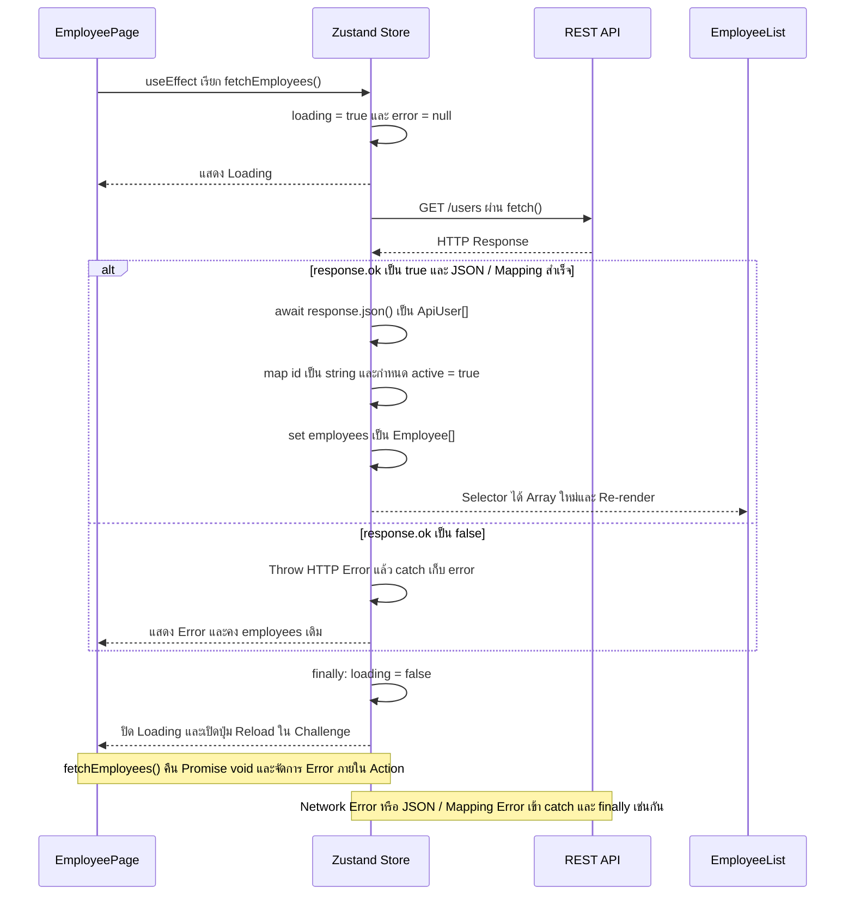

<div align="center">

  # Workshop 05: Async Actions & API

  โหลดข้อมูลจาก REST API ด้วย Zustand + TypeScript  
  พร้อมจัดการ Loading, Error และการแปลงข้อมูลก่อนเข้า Store

  
  
  

  [← Workshop 04](../workshop04-objects_arrays/README.md) · [หน้าหลัก](../../../README.md) · [Zustand Docs](https://zustand.docs.pmnd.rs/)

  <br />
  <br />

  

</div>

---

## เกี่ยวกับ Workshop

ใน Workshop 04 เราสร้าง Employee Store ที่สามารถเพิ่ม ลบ และเปลี่ยนสถานะพนักงานได้ แต่ข้อมูลทั้งหมดยังอยู่ภายใน Frontend

Workshop นี้จะเพิ่ม **Async Action** เพื่อดึงข้อมูลจาก Backend API แล้วนำมาเก็บใน Zustand Store โดยใช้ `fetch()`, `async/await` และ TypeScript พร้อมดูแลสถานะ Loading และ Error ให้ UI ตอบสนองอย่างเหมาะสม

## เป้าหมายการเรียนรู้

เมื่อจบ Workshop นี้ คุณจะสามารถ:

- สร้าง Async Action ใน Zustand Store ได้
- เรียก REST API ด้วย `fetch()` และ `async/await` ได้
- กำหนด Type ให้ข้อมูลที่ได้รับจาก API ได้
- แปลง API Model เป็น Model ที่ Frontend ใช้งานได้
- จัดการ Loading และ Error State ด้วย `try/catch/finally` ได้
- เรียก Async Action เมื่อ Component Mount ด้วย `useEffect` ได้
- สร้างปุ่ม Reload และป้องกันการเรียกซ้ำระหว่าง Loading ได้

## สารบัญ

1. [Async Action คืออะไร?](#1-async-action-คืออะไร)
2. [เตรียม API และ Type](#2-เตรียม-api-และ-type)
3. [เพิ่ม Async Action ใน Store](#3-เพิ่ม-async-action-ใน-store)
4. [ลำดับการเปลี่ยน State](#4-ลำดับการเปลี่ยน-state)
5. [เรียก Action จาก React Component](#5-เรียก-action-จาก-react-component)
6. [Workshop Challenge](#6-workshop-challenge)
7. [คำถามทบทวน](#7-คำถามทบทวน)
8. [สิ่งที่ต้องส่งก่อนขึ้น Workshop 06](#สิ่งที่ต้องส่งก่อนขึ้น-workshop-06)

---

## 1. Async Action คืออะไร?

Action จาก Workshop 04 ทำงานแบบ Synchronous เพราะสามารถอัปเดต State ได้ทันที:

```ts
addEmployee: (employee) => {
  set((state) => ({
    employees: [...state.employees, employee],
  }));
},
```

เมื่อข้อมูลมาจาก Backend เราต้องรอ HTTP Response ก่อนจึงจะอัปเดต Store ได้:

```ts
fetchEmployees: async () => {
  const response = await fetch("/api/employees");
  const data = await response.json();

  set({ employees: data });
},
```

Zustand รองรับ Async Actions ได้โดยตรง ไม่ต้องติดตั้ง Middleware เพิ่มสำหรับการเรียก API

### Data Flow ของ Async Action

แผนภาพนี้แสดงเส้นทางเมื่อโหลดข้อมูลและแปลง Model สำเร็จ:



### Type ของ Async Action

Action ปกติ:

```ts
addEmployee: (employee: Employee) => void;
```

Async Action:

```ts
fetchEmployees: () => Promise<void>;
```

ฟังก์ชันที่ประกาศด้วย `async` จะคืนค่าเป็น Promise เสมอ ในกรณีนี้ `Promise<void>` หมายถึง Action ไม่ได้ส่งข้อมูลกลับให้ผู้เรียกนำไปใช้ต่อ แต่จัดเก็บผลลัพธ์ไว้ใน Store

## 2. เตรียม API และ Type

Workshop นี้ใช้ [JSONPlaceholder — Users API](https://jsonplaceholder.typicode.com/users) เป็น Fake REST API สำหรับทดลอง

ข้อมูลจาก API มีรูปแบบประมาณนี้:

```json
{
  "id": 1,
  "name": "Leanne Graham",
  "username": "Bret",
  "email": "example@example.com"
}
```

ข้อมูล API แตกต่างจาก `Employee` ที่เราใช้งานอยู่สองจุด:

- API ส่ง `id` เป็น `number` แต่ Employee ใช้ `string`
- API ไม่มี Property `active`

จึงต้องกำหนด Type ของ API แยกจาก Domain Model และแปลงข้อมูลก่อนเก็บลง Store

### 2.1 สร้าง Type สำหรับ API

สร้างไฟล์ `src/types/apiUser.ts`:

```ts
export interface ApiUser {
  id: number;
  name: string;
  username: string;
  email: string;
}
```

`ApiUser` แทนรูปแบบข้อมูลที่ API ส่งกลับมา โดยระบุเฉพาะ Fields ที่ใช้ใน Workshop

### 2.2 แปลง ApiUser เป็น Employee

Employee Type เดิม:

```ts
export interface Employee {
  id: string;
  name: string;
  active: boolean;
}
```

ใช้ `map()` แปลง `ApiUser[]` เป็น `Employee[]`:

```ts
const employees: Employee[] = data.map((user) => ({
  id: String(user.id),
  name: user.name,
  active: true,
}));
```

| ข้อมูลจาก API | ข้อมูลใน Employee | วิธีแปลง |
| --- | --- | --- |
| `id: 1` | `id: "1"` | `String(user.id)` |
| `name: "Leanne Graham"` | `name: "Leanne Graham"` | ใช้ค่าเดิม |
| ไม่มี `active` | `active: true` | กำหนดค่าเริ่มต้น |

> [!NOTE]
> `active: true` เป็นค่าที่เรากำหนดเพื่อใช้ใน Workshop ไม่ใช่สถานะจริงที่ API ส่งมา

### ทำไมต้องแยก ApiUser กับ Employee?

โครงสร้างข้อมูลจาก Backend ไม่จำเป็นต้องเหมือนกับข้อมูลที่ Frontend ต้องการใช้ การแยก Type ช่วยให้เห็นขอบเขตชัดเจน:

```text
Backend API           Mapping Layer           Frontend Store
ApiUser[]       ──▶   data.map(...)     ──▶   Employee[]
```

เมื่อ API เปลี่ยน เราสามารถแก้ Mapping โดยไม่ต้องกระจาย Logic การแปลงข้อมูลไปทั่ว Components

## 3. เพิ่ม Async Action ใน Store

เปิด `src/stores/useEmployeeStore.ts` แล้วเพิ่มส่วนต่อไปนี้โดยไม่ลบ Actions เดิม

### 3.1 เพิ่ม Import

```ts
import type { ApiUser } from "../types/apiUser";
```

### 3.2 เพิ่ม State และ Action ใน Interface

```ts
interface EmployeeStore {
  // State และ Actions เดิม
  employees: Employee[];
  addEmployee: (employee: Employee) => void;
  removeEmployee: (id: string) => void;
  toggleEmployeeActive: (id: string) => void;

  // State และ Action ใหม่
  loading: boolean;
  error: string | null;
  fetchEmployees: () => Promise<void>;
}
```

| Property | Type | หน้าที่ |
| --- | --- | --- |
| `loading` | `boolean` | ระบุว่า API กำลังทำงานอยู่หรือไม่ |
| `error` | `string \| null` | เก็บข้อความ Error หรือ `null` เมื่อไม่มี Error |
| `fetchEmployees` | `() => Promise<void>` | โหลดและแปลงข้อมูลจาก API |

กำหนดค่าเริ่มต้น:

```ts
employees: [],
loading: false,
error: null,
```

เราเริ่ม `employees` ด้วย Array ว่าง เพราะข้อมูลจะมาจาก API

### 3.3 เพิ่ม fetchEmployees

```ts
fetchEmployees: async () => {
  set({ loading: true, error: null });

  try {
    const response = await fetch(
      "https://jsonplaceholder.typicode.com/users",
    );

    if (!response.ok) {
      throw new Error(`HTTP Error: ${response.status}`);
    }

    const data: ApiUser[] = await response.json();

    const employees: Employee[] = data.map((user) => ({
      id: String(user.id),
      name: user.name,
      active: true,
    }));

    set({ employees });
  } catch (error) {
    set({
      error:
        error instanceof Error
          ? error.message
          : "Failed to fetch employees",
    });
  } finally {
    set({ loading: false });
  }
},
```

### ช่วงที่ 1 — เริ่ม Loading

```ts
set({ loading: true, error: null });
```

ก่อนเริ่ม Request เรากำหนด `loading` เป็น `true` และล้าง Error จากการเรียกครั้งก่อน

### ช่วงที่ 2 — เรียก API

```ts
const response = await fetch(url);
```

`await` รอ Promise จาก `fetch()` สำเร็จก่อนทำบรรทัดถัดไป โดยไม่บล็อกการทำงานของหน้าเว็บทั้งหมด

จากนั้นตรวจสอบ HTTP Status:

```ts
if (!response.ok) {
  throw new Error(`HTTP Error: ${response.status}`);
}
```

> [!IMPORTANT]
> `fetch()` ไม่ Throw Error อัตโนมัติเมื่อ Server ตอบ HTTP 404 หรือ 500 จึงต้องตรวจ `response.ok` ด้วยตัวเอง

### ช่วงที่ 3 — อ่านและแปลงข้อมูล

```ts
const data: ApiUser[] = await response.json();
```

เรากำหนด Type ให้ข้อมูลที่ได้จาก JSON เพื่อให้ TypeScript ช่วยตรวจสอบการใช้งานในโค้ด

> [!WARNING]
> Type Annotation ไม่ได้ตรวจสอบว่าข้อมูลจาก API ตรงกับ `ApiUser` จริงใน Runtime ระบบ Production ควรพิจารณา Runtime Validation เช่น Schema Validator

หลังแปลงข้อมูลเป็น `Employee[]` แล้ว จึงอัปเดต Store:

```ts
set({ employees });
```

### ช่วงที่ 4 — จัดการ Error และจบ Loading

```ts
catch (error) {
  // จัดการข้อผิดพลาด
} finally {
  set({ loading: false });
}
```

- `catch` ทำงานเมื่อเกิด Error ภายใน `try`
- `finally` ทำงานเสมอหลัง `try` หรือ `catch`
- การปิด Loading ใน `finally` ทำให้ทั้งกรณี Success และ Error กลับสู่สถานะไม่โหลด

## 4. ลำดับการเปลี่ยน State

### กรณีสำเร็จและเกิดข้อผิดพลาด



เมื่อสำเร็จ Array ใหม่จาก API จะแทนที่ `employees` เดิม แต่เมื่อเกิด Error โค้ดใน `catch` เก็บเฉพาะข้อความ Error โดยไม่ได้ล้างรายชื่อ หากเคยโหลดสำเร็จแล้ว UI จึงยังแสดงข้อมูลเดิมระหว่าง Reload หรือเมื่อ Reload ล้มเหลวได้

State lifecycle ที่ควรจำ:

```text
Idle → Loading → Success
Idle → Loading → Error
```

## 5. เรียก Action จาก React Component

สร้าง `src/components/EmployeePage.tsx`:

```tsx
import { useEffect } from "react";
import { useEmployeeStore } from "../stores/useEmployeeStore";
import EmployeeForm from "./EmployeeForm";
import EmployeeList from "./EmployeeList";

const EmployeePage = () => {
  const fetchEmployees = useEmployeeStore(
    (state) => state.fetchEmployees,
  );
  const loading = useEmployeeStore((state) => state.loading);
  const error = useEmployeeStore((state) => state.error);

  useEffect(() => {
    void fetchEmployees();
  }, [fetchEmployees]);

  return (
    <div>
      <h1>Employee Management</h1>

      {loading && <p>Loading employees...</p>}
      {error && <p style={{ color: "red" }}>{error}</p>}

      <EmployeeForm />
      <EmployeeList />
    </div>
  );
};

export default EmployeePage;
```

### ทำไมต้องใช้ useEffect?

```tsx
useEffect(() => {
  void fetchEmployees();
}, [fetchEmployees]);
```

เราต้องการเรียก API หลัง Component Mount ไม่ใช่ระหว่าง Render เพราะการอัปเดต State ระหว่าง Render อาจทำให้เกิด Render Loop

- `void` แสดงเจตนาว่าไม่ได้รอ Promise ใน Effect นี้
- Error ถูกจัดการภายใน Store แล้ว
- `[fetchEmployees]` คือ Dependency Array ของ Effect

> [!NOTE]
> ใน Development ที่เปิด React Strict Mode อาจเห็น API ถูกเรียกสองครั้งตอน Mount เนื่องจาก React ตรวจสอบ Effects เพิ่มเติม ไม่ได้หมายความว่า Zustand ทำงานผิด

เมื่อ Request สำเร็จ `EmployeeList` เดิมจะแสดงข้อมูลใหม่จาก Store โดยไม่ต้องมี Fetch Logic ซ้ำใน List

### ลำดับ Request และการอัปเดต UI



ภาพเปิดบทและไฟล์ต้นฉบับ Diagram เก็บอยู่ใน `assets-repo`:

- [ภาพ Async Actions & API](../../../assets-repo/images/workshop05-async-actions-api-hero.png)
- [Flowchart: Async Action Data Flow](../../../assets-repo/diagrams/workshop05-async-data-flow.mmd)
- [Flowchart: Loading, Success และ Error](../../../assets-repo/diagrams/workshop05-async-state-flow.mmd)
- [Sequence Diagram: Fetch และ UI Update](../../../assets-repo/diagrams/workshop05-fetch-sequence.mmd)

Mermaid จะแสดงเป็นแผนภาพบน GitHub และ Markdown Viewer ที่รองรับ ส่วนไฟล์ `.mmd` สามารถนำไปแก้ไขหรือ Export เป็นภาพต่อได้

## 6. Workshop Challenge

ทดลองต่อยอด Async Action ให้ UI รองรับการ Reload และแสดงสถานะครบถ้วน

### ภารกิจที่ต้องทำ

**ความคืบหน้า: 4/4**

- [x] **Challenge A — API Fetch:** เพิ่ม `fetchEmployees` และโหลดข้อมูลสำเร็จ
- [x] **Challenge B — Refresh Button:** เพิ่มปุ่ม Reload Employees
- [x] **Challenge C — Loading State:** Disable ปุ่มและแสดง Loading ระหว่าง Request
- [x] **Challenge D — Error State:** ทดลอง URL ที่ไม่ถูกต้องและแสดง Error

### Refresh Button

<details>
<summary><strong>เปิดคำใบ้</strong></summary>

เลือก Action และ Loading State จาก Store:

```tsx
const fetchEmployees = useEmployeeStore((state) => state.fetchEmployees);
const loading = useEmployeeStore((state) => state.loading);
```

เรียก Action จาก Event Handler และ Disable ปุ่มระหว่าง Loading:

```tsx
<button
  disabled={loading}
  onClick={() => void fetchEmployees()}
>
  {loading ? "Loading..." : "Reload Employees"}
</button>
```

</details>

### ทดสอบ Error State

<details>
<summary><strong>เปิดคำใบ้</strong></summary>

เปลี่ยน URL เป็น Endpoint ที่ไม่มีอยู่ชั่วคราว แล้วตรวจสอบว่า:

- `response.ok` เป็น `false`
- `catch` บันทึกข้อความลง `error`
- UI แสดงข้อความ Error
- `finally` เปลี่ยน `loading` กลับเป็น `false`

หลังทดสอบเสร็จให้เปลี่ยน URL กลับเป็น Endpoint ที่ถูกต้อง

</details>

> [!IMPORTANT]
> เมื่อ Reload สำเร็จ ข้อมูลจาก API จะแทนที่ Array เดิม ดังนั้นพนักงานที่เพิ่มเฉพาะใน Frontend อาจหายไป ระบบนี้ยังไม่ได้บันทึกการเปลี่ยนแปลงกลับไปยัง Backend

## 7. คำถามทบทวน

### 1. ทำไม fetchEmployees จึงมี Return Type เป็น Promise<void>?

- A. เพราะเป็น Async Action ที่ไม่ส่งผลลัพธ์กลับให้ผู้เรียกนำไปใช้ต่อ
- B. เพราะ Promise ใช้เก็บ Array เท่านั้น
- C. เพราะ Zustand บังคับทุก Action ให้เป็น Promise

<details>
<summary><strong>ดูคำตอบ</strong></summary>

**คำตอบ: A** — ฟังก์ชัน `async` คืน Promise เสมอ และ Action นี้เก็บผลลัพธ์ใน Store แทนการ Return ข้อมูลให้ผู้เรียก

</details>

### 2. ทำไมจึงควรใช้ finally จัดการ loading?

- A. เพราะ `finally` ใช้แปลง JSON
- B. เพราะ `finally` ทำงานหลัง `try/catch` ไม่ว่าจะสำเร็จหรือเกิด Error
- C. เพราะ `finally` ทำให้ API ตอบเร็วขึ้น

<details>
<summary><strong>ดูคำตอบ</strong></summary>

**คำตอบ: B** — การกำหนด `loading: false` ใน `finally` รับประกันว่า Loading จะสิ้นสุดในทุกกรณี

</details>

### 3. ทำไมต้องแปลง ID ด้วย String(user.id)?

- A. เพราะ API ส่ง `number` แต่ Employee Type กำหนด `string`
- B. เพราะ Zustand เก็บได้เฉพาะ `string`
- C. เพราะ `fetch()` ไม่รองรับ `number`

<details>
<summary><strong>ดูคำตอบ</strong></summary>

**คำตอบ: A** — Mapping ทำให้ข้อมูลจาก API ตรงกับ Type ที่ Frontend กำหนดไว้

</details>

## สิ่งที่ต้องส่งก่อนขึ้น Workshop 06

1. `apiUser.ts` — Type ของข้อมูลจาก API
2. `useEmployeeStore.ts` — Async Action พร้อม Loading และ Error Handling
3. `EmployeePage.tsx` — เรียก API ตอน Mount และมีปุ่ม Reload
4. คำตอบของคำถามทบทวนทั้งสามข้อ

สิ่งที่จะตรวจ:

- การใช้ `async/await` และ TypeScript
- การตรวจ HTTP Status ด้วย `response.ok`
- การแปลง API Model เป็น Employee Model
- การจัดการ Loading และ Error ด้วย `try/catch/finally`
- การเรียก Async Action จาก `useEffect` และ Event Handler

---

<div align="center">

  **ถัดไป:** [Workshop 06 — Persist Middleware](../workshop06-persist/README.md)

  [← Workshop 04](../workshop04-objects_arrays/README.md) · [กลับสู่หน้าหลัก](../../../README.md)

</div>
