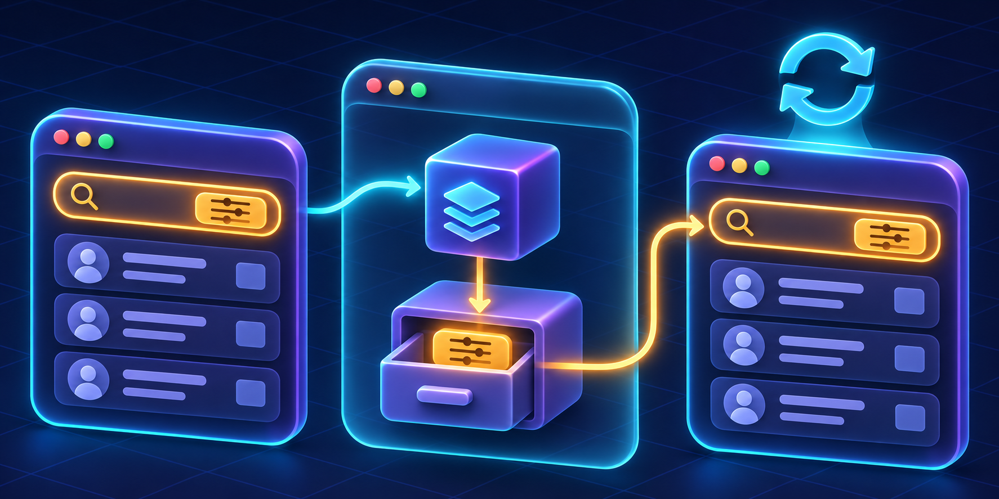
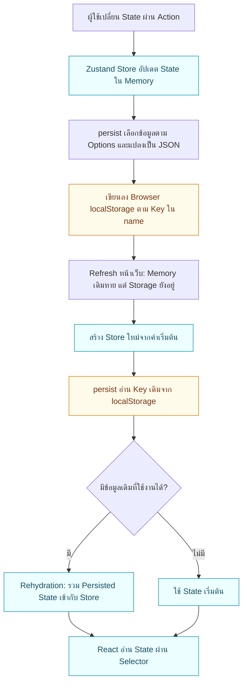
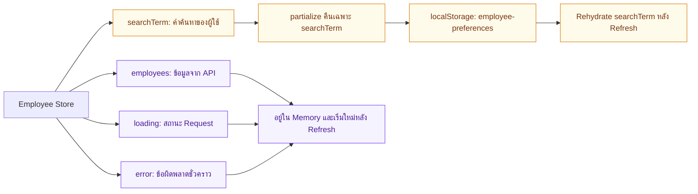
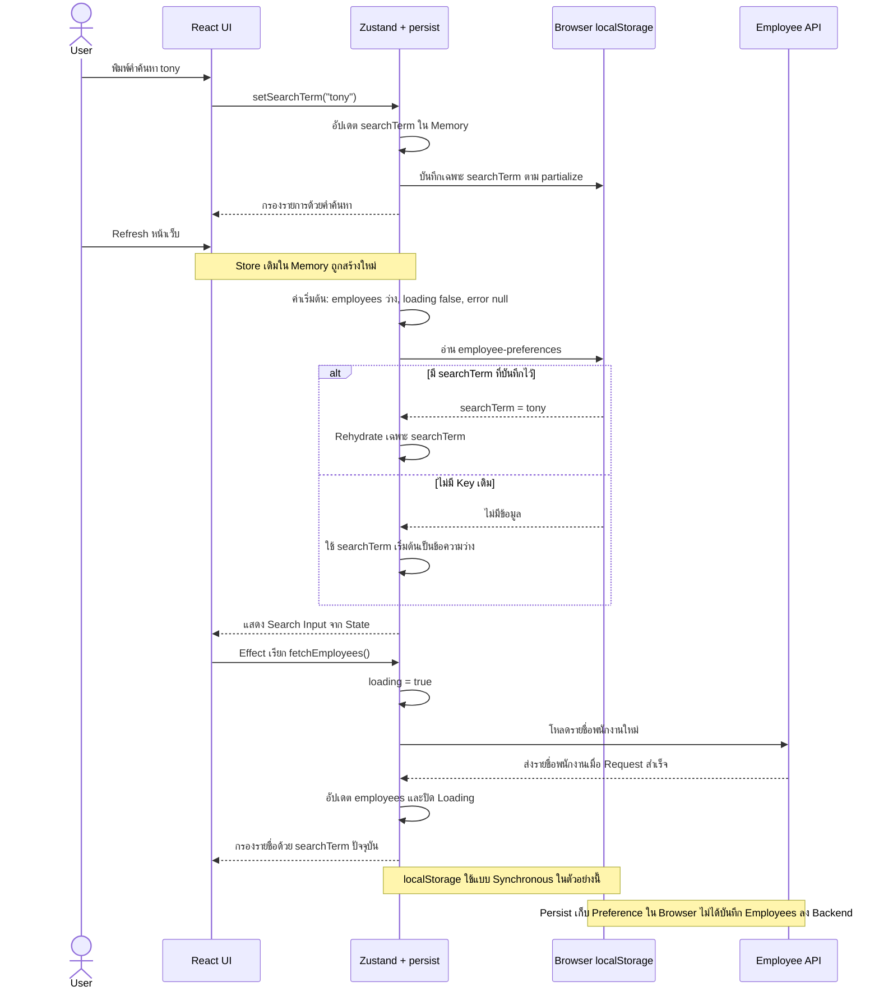

<div align="center">

  # Workshop 06: Persist Middleware

  จัดเก็บ Zustand State ลงใน Browser Storage  
  และกู้คืนข้อมูลอัตโนมัติหลัง Refresh ด้วย TypeScript

  
  
  

  [← Workshop 05](../workshop05-async_action_api/README.md) · [หน้าหลัก](../../../README.md) · [Zustand Docs](https://zustand.docs.pmnd.rs/)

  <br />
  <br />

  

</div>

---

## เกี่ยวกับ Workshop

โดยปกติ Zustand เก็บ State ไว้ในหน่วยความจำของ JavaScript เมื่อผู้ใช้ Refresh หน้าเว็บ State จะกลับเป็นค่าเริ่มต้น

Workshop นี้จะใช้ `persist` middleware เพื่อบันทึก State บางส่วนลงใน `localStorage` และกู้คืนค่าเมื่อเปิดหน้าเว็บอีกครั้ง โดยต่อยอด Employee Management จาก Workshop 05 ให้จดจำคำค้นหาของผู้ใช้

## เป้าหมายการเรียนรู้

เมื่อจบ Workshop นี้ คุณจะสามารถ:

- อธิบายความแตกต่างระหว่าง Memory State กับ Persisted State ได้
- ครอบ Zustand Store ด้วย `persist` middleware ได้
- กำหนด Storage Key ด้วย Option `name` ได้
- เลือก State ที่ต้องการบันทึกด้วย `partialize` ได้
- อธิบายกระบวนการ Rehydration ได้
- จดจำ Search Preference หลัง Refresh ได้
- ระบุข้อมูลที่ไม่ควรเก็บใน `localStorage` ได้

## สารบัญ

1. [Persist คืออะไร?](#1-persist-คืออะไร)
2. [ทดลอง Persist กับ Counter Store](#2-ทดลอง-persist-กับ-counter-store)
3. [เลือก State ด้วย partialize](#3-เลือก-state-ด้วย-partialize)
4. [นำ Persist มาใช้กับ Employee Store](#4-นำ-persist-มาใช้กับ-employee-store)
5. [ทดลองและตรวจสอบผลลัพธ์](#5-ทดลองและตรวจสอบผลลัพธ์)
6. [ข้อควรระวังในการใช้ Persist](#6-ข้อควรระวังในการใช้-persist)
7. [Workshop Challenge](#7-workshop-challenge)
8. [คำถามทบทวน](#8-คำถามทบทวน)
9. [สิ่งที่ต้องส่งก่อนขึ้น Workshop 07](#สิ่งที่ต้องส่งก่อนขึ้น-workshop-07)

---

## 1. Persist คืออะไร?

State ใน Zustand Store ปกติอยู่ใน Memory:

```ts
employees: [],
loading: false,
error: null,
```

เมื่อ Refresh หน้าเว็บ JavaScript Runtime เริ่มต้นใหม่และข้อมูลใน Memory หายไป แต่ `persist` middleware สามารถบันทึก State ลง Storage และนำกลับมาใส่ Store เมื่อเปิดหน้าเว็บใหม่ได้



การนำข้อมูลจาก Storage กลับมาใส่ Store เรียกว่า **Rehydration** ซึ่ง Zustand Persist จัดการให้อัตโนมัติในกรณีทั่วไป

### เปรียบเทียบ Zustand ปกติกับ Persist

| ความสามารถ | Zustand ปกติ | Zustand + Persist |
| --- | :---: | :---: |
| เก็บ State ใน Memory | ✅ | ✅ |
| เก็บข้อมูลข้าม Refresh | ❌ | ✅ |
| ใช้ `localStorage` อัตโนมัติ | ❌ | ✅ |
| ต้องติดตั้ง Library เพิ่ม | ❌ | ❌ |
| บันทึกข้อมูลลง Backend/Database | ❌ | ❌ |

> [!IMPORTANT]
> Persist ไม่ใช่ Database ข้อมูลใน `localStorage` อยู่ภายใน Browser ของผู้ใช้ และไม่ได้ถูกบันทึกลง Backend

## 2. ทดลอง Persist กับ Counter Store

เริ่มจาก Counter Store ขนาดเล็กเพื่อดู Syntax ของ Middleware ให้ชัดเจน:

```ts
import { create } from "zustand";
import { persist } from "zustand/middleware";

interface CounterStore {
  count: number;
  increase: () => void;
}

export const useCounterStore = create<CounterStore>()(
  persist(
    (set) => ({
      count: 0,

      increase: () => {
        set((state) => ({
          count: state.count + 1,
        }));
      },
    }),
    {
      name: "counter-storage",
    },
  ),
);
```

มีส่วนสำคัญเพิ่มขึ้นสองส่วน

### 2.1 ครอบ Store ด้วย persist

```ts
create<CounterStore>()(
  persist(
    (set) => ({
      // State และ Actions
    }),
    {
      // Persist Options
    },
  ),
);
```

`persist()` ครอบ State Creator เดิมเพื่อสังเกตการเปลี่ยนแปลงและบันทึก State ตาม Options ที่กำหนด

### 2.2 กำหนดชื่อ Storage

```ts
{
  name: "counter-storage",
}
```

`name` คือ Key ที่ใช้เก็บข้อมูลใน Storage แต่ละ Persist Store ควรมีชื่อที่ไม่ซ้ำกัน

หากไม่ได้กำหนด Storage อื่น Zustand Persist จะใช้ `localStorage` เป็นค่าเริ่มต้น

เมื่อ `count` มีค่าเป็น `5` ข้อมูลที่บันทึกไว้จะมีโครงสร้างประมาณนี้:

```json
{
  "state": {
    "count": 5
  },
  "version": 0
}
```

ตรวจสอบข้อมูลได้ใน Chrome DevTools:

```text
Application → Local Storage → เลือก Origin → counter-storage
```

### ลำดับการทำงาน

```text
1. Store เริ่มต้นด้วย count: 0
2. ผู้ใช้เรียก increase() → count: 1
3. Persist บันทึกค่าใน localStorage
4. ผู้ใช้ Refresh หน้าเว็บ
5. Persist อ่านข้อมูลจาก localStorage
6. Rehydrate Store → count: 1
```

## 3. เลือก State ด้วย partialize

ในโปรเจกต์จริง เราไม่จำเป็นต้อง Persist ทุก State

สมมติ Employee Store มีข้อมูลดังนี้:

```ts
employees: [],
loading: false,
error: null,
searchTerm: "",
```

แต่ละ State มีอายุและแหล่งที่มาต่างกัน:

| State | ควร Persist? | เหตุผล |
| --- | :---: | --- |
| `employees` | ❌ | เป็นข้อมูลจาก Backend ควรโหลดใหม่ตามความเหมาะสม |
| `loading` | ❌ | เป็นสถานะชั่วคราวของ Request |
| `error` | ❌ | เป็นข้อผิดพลาดจาก Request ก่อนหน้า |
| `searchTerm` | ✅ | เป็น Preference ที่ผู้ใช้อาจต้องการใช้ต่อ |

ใช้ `partialize` เพื่อเลือกเฉพาะ State ที่ต้องการบันทึก:

```ts
{
  name: "employee-preferences",
  partialize: (state) => ({
    searchTerm: state.searchTerm,
  }),
}
```

แม้ Store จะมีหลาย Properties แต่ Persisted State จะมีเฉพาะ `searchTerm`



```json
{
  "state": {
    "searchTerm": "tony"
  },
  "version": 0
}
```

> [!TIP]
> เริ่มจาก Persist ให้น้อยที่สุด แล้วเพิ่มเฉพาะ State ที่มีเหตุผลชัดเจนว่าควรอยู่ข้าม Session หรือ Refresh

## 4. นำ Persist มาใช้กับ Employee Store

เป้าหมายคือจดจำคำค้นหาพนักงานหลัง Refresh ขณะที่รายชื่อพนักงานยังโหลดใหม่จาก API ตามเดิม

### 4.1 เพิ่ม Search State

เปิด `src/stores/useEmployeeStore.ts` แล้วเพิ่มใน Interface:

```ts
searchTerm: string;
setSearchTerm: (value: string) => void;
```

เพิ่ม State และ Action:

```ts
searchTerm: "",

setSearchTerm: (value) => {
  set({ searchTerm: value });
},
```

นี่คือ Action ที่รับ Parameter ซึ่งต่อยอดจาก Workshop 02

### 4.2 เพิ่ม Persist Middleware

เพิ่ม Import:

```ts
import { persist } from "zustand/middleware";
```

เปลี่ยนจาก State Creator ปกติ:

```ts
create<EmployeeStore>()((set) => ({
  // State และ Actions
}));
```

เป็น State Creator ที่ครอบด้วย `persist`:

```ts
create<EmployeeStore>()(
  persist(
    (set) => ({
      // State และ Actions ทั้งหมดจาก Store เดิม
      // รวม searchTerm และ setSearchTerm
    }),
    {
      name: "employee-preferences",
      partialize: (state) => ({
        searchTerm: state.searchTerm,
      }),
    },
  ),
);
```

> [!NOTE]
> ตัวอย่างนี้แสดงเฉพาะโครงสร้างวงเล็บที่เปลี่ยน ไม่ใช่ Store ฉบับเต็ม ไม่ต้องลบ `fetchEmployees`, `addEmployee`, `removeEmployee` หรือ `toggleEmployeeActive`

Middleware ครอบ Store อยู่ภายนอก Actions จึงไม่จำเป็นต้องแก้ Logic ของ Actions เดิม

### 4.3 เพิ่ม Search Input

เปิด `src/components/EmployeePage.tsx` แล้วเลือก State และ Action:

```tsx
const searchTerm = useEmployeeStore((state) => state.searchTerm);
const setSearchTerm = useEmployeeStore((state) => state.setSearchTerm);
```

เพิ่ม Input:

```tsx
<input
  type="text"
  value={searchTerm}
  onChange={(event) => setSearchTerm(event.target.value)}
  placeholder="Search employee..."
/>
```

เราไม่ใช้ `useState` กับ Input นี้ เพราะต้องการให้คำค้นหาอยู่ใน Zustand Store และถูก Persist ข้ามการ Refresh

### 4.4 กรอง Employee ด้วย searchTerm

เปิด `src/components/EmployeeList.tsx` แล้วเลือก `searchTerm`:

```tsx
const searchTerm = useEmployeeStore((state) => state.searchTerm);
```

สร้าง Array ที่ผ่านการกรอง:

```tsx
const filteredEmployees = employees.filter((employee) =>
  employee.name
    .toLowerCase()
    .includes(searchTerm.trim().toLowerCase()),
);
```

เปลี่ยนจาก:

```tsx
employees.map((employee) => /* ... */)
```

เป็น:

```tsx
filteredEmployees.map((employee) => /* ... */)
```

เรา Subscribe `employees` และ `searchTerm` แยกกันด้วย Selectors ธรรมดา จึงไม่ต้องใช้ `useShallow`

## 5. ทดลองและตรวจสอบผลลัพธ์

### ขั้นตอนทดสอบ

1. เปิดหน้า Employee Management
2. รอให้รายชื่อพนักงานโหลดจาก API
3. พิมพ์ชื่อบางส่วนในช่อง Search
4. ตรวจสอบว่ารายการถูกกรองตามคำค้นหา
5. เปิด DevTools และดู Key `employee-preferences`
6. Refresh หน้าเว็บ
7. ตรวจสอบว่าคำค้นหายังคงอยู่
8. ตรวจสอบว่ารายชื่อพนักงานถูกโหลดใหม่จาก API

### State ก่อนและหลัง Refresh

แผนภาพนี้แสดงกรณีใช้ `localStorage` ตามตัวอย่างในบท โดยคำค้นหาถูกกู้คืนจาก Storage ก่อน Component เรียกโหลดรายชื่อพนักงานใหม่:



เฉพาะ `searchTerm` ถูกกู้คืนจาก Storage ส่วน `employees` จะเริ่มจาก Array ว่างและโหลดใหม่จาก API

ภาพเปิดบทและไฟล์ต้นฉบับ Diagram เก็บอยู่ใน `assets-repo`:

- [ภาพ Persist Middleware](../../../assets-repo/images/workshop06-persist-hero.png)
- [Flowchart: Persist และ Rehydration](../../../assets-repo/diagrams/workshop06-persist-overview.mmd)
- [Flowchart: เลือก State ด้วย partialize](../../../assets-repo/diagrams/workshop06-partialize-flow.mmd)
- [Sequence Diagram: บันทึกคำค้นหาและ Refresh](../../../assets-repo/diagrams/workshop06-rehydration-sequence.mmd)

Mermaid จะแสดงเป็นแผนภาพบน GitHub และ Markdown Viewer ที่รองรับ ส่วนไฟล์ `.mmd` สามารถนำไปแก้ไขหรือ Export เป็นภาพต่อได้

### ล้างข้อมูลระหว่างทดสอบ

สามารถลบ Key `employee-preferences` จาก DevTools เพื่อทดสอบ Store ที่ไม่มีข้อมูลเดิมได้

> [!WARNING]
> การล้าง Site Data อาจลบข้อมูลอื่นของ Origin เดียวกันด้วย หากต้องการทดสอบเฉพาะ Store นี้ให้ลบเฉพาะ Key ที่กำหนดใน `name`

## 6. ข้อควรระวังในการใช้ Persist

### 6.1 ไม่ควร Persist ทุก State

หลีกเลี่ยงการเก็บ `loading`, `error` หรือข้อมูลที่ควรดึงใหม่จาก API เพราะข้อมูลเหล่านี้อาจเก่าและไม่ตรงกับ Backend

### 6.2 localStorage ไม่ใช่ที่เก็บความลับ

อย่าเก็บข้อมูลต่อไปนี้ใน `localStorage`:

- Password
- API Secret หรือ Private Key
- ข้อมูลส่วนบุคคลที่มีความอ่อนไหว
- Token โดยไม่พิจารณาความเสี่ยงด้าน XSS และ Security Model ของระบบ

JavaScript ในหน้าเว็บสามารถเข้าถึง `localStorage` ได้ หากเกิดช่องโหว่ XSS ผู้โจมตีอาจอ่านข้อมูลเหล่านี้ได้

### 6.3 Persist ไม่ได้ซิงก์กับ Backend

หาก Persist รายชื่อพนักงาน ข้อมูลอาจอยู่ใน Browser หลัง Refresh แต่ไม่ได้หมายความว่าถูกบันทึกลง Database หรือมองเห็นจากอุปกรณ์อื่น

### 6.4 ตรวจสอบข้อมูลจาก Storage

ผู้ใช้หรือ Extension สามารถแก้ข้อมูลใน `localStorage` ได้ และ TypeScript ไม่สามารถรับประกันรูปแบบ JSON ใน Runtime ข้อมูลสำคัญควรถูกตรวจสอบก่อนนำมาใช้งาน

### 6.5 วางแผนเมื่อโครงสร้าง State เปลี่ยน

Persisted State อาจถูกสร้างจากแอปเวอร์ชันเก่า เมื่อ Schema เปลี่ยนควรพิจารณาใช้ Version และ Migration เพื่อแปลงข้อมูลเดิมให้เข้ากับรูปแบบใหม่

## 7. Workshop Challenge

นำ Persist มาใช้กับระบบค้นหาพนักงานและตรวจสอบผลหลัง Refresh

### ภารกิจที่ต้องทำ

**ความคืบหน้า: 6/6**

- [x] เพิ่ม `searchTerm` และ `setSearchTerm` ใน Employee Store
- [x] ครอบ Employee Store ด้วย `persist` middleware
- [x] ใช้ `partialize` บันทึกเฉพาะ `searchTerm`
- [x] เพิ่ม Search Input ใน `EmployeePage`
- [x] กรองพนักงานใน `EmployeeList`
- [x] Refresh และตรวจสอบว่าคำค้นหายังคงอยู่

### Challenge เพิ่มเติม — ตรวจสอบ Storage

<details>
<summary><strong>เปิดขั้นตอนตรวจสอบ</strong></summary>

1. เปิด DevTools ที่แท็บ Application
2. เลือก Local Storage ของเว็บไซต์
3. เปิด Key `employee-preferences`
4. ตรวจสอบว่า `state` มีเฉพาะ `searchTerm`
5. เปลี่ยนคำค้นหาและสังเกตค่าที่ Storage
6. ลบ Key แล้ว Refresh เพื่อดูค่าเริ่มต้น

</details>

## 8. คำถามทบทวน

### 1. persist ทำหน้าที่อะไร?

- A. บันทึก State บางส่วนหรือทั้งหมดลง Storage เพื่อกู้คืนได้
- B. บันทึกข้อมูลลง Backend อัตโนมัติ
- C. ทำให้ API ตอบเร็วขึ้น

<details>
<summary><strong>ดูคำตอบ</strong></summary>

**คำตอบ: A** — Persist middleware บันทึก State ลง Storage และ Rehydrate กลับเข้า Store เมื่อเริ่มใช้งานครั้งถัดไป

</details>

### 2. partialize ใช้ทำอะไร?

- A. เลือกเฉพาะ State ที่ต้องการบันทึก
- B. แปลง Action ให้เป็น Promise
- C. เลือกเฉพาะ Component ที่ต้อง Re-render

<details>
<summary><strong>ดูคำตอบ</strong></summary>

**คำตอบ: A** — `partialize` รับ State ทั้งหมดแล้วคืนเฉพาะส่วนที่ Persist ควรจัดเก็บ

</details>

### 3. ทำไมไม่ควร Persist loading?

- A. เพราะ `boolean` เก็บใน `localStorage` ไม่ได้
- B. เพราะเป็นสถานะชั่วคราวและอาจไม่ตรงกับ Request หลังเปิดหน้าใหม่
- C. เพราะ Persist รองรับเฉพาะ `string`

<details>
<summary><strong>ดูคำตอบ</strong></summary>

**คำตอบ: B** — Request เดิมสิ้นสุดไปแล้วเมื่อหน้าเว็บถูกปิด ค่า Loading จาก Session ก่อนจึงไม่มีความหมายกับ Session ใหม่

</details>

## สิ่งที่ต้องส่งก่อนขึ้น Workshop 07

1. `useEmployeeStore.ts` — Persist middleware และ `partialize`
2. `EmployeePage.tsx` — Search Input ที่เชื่อมกับ Store
3. `EmployeeList.tsx` — การกรอง Employees ด้วย `searchTerm`
4. คำตอบของคำถามทบทวนทั้งสามข้อ

สิ่งที่จะตรวจ:

- โครงสร้าง `persist` middleware และวงเล็บ
- การกำหนด Storage Key ด้วย `name`
- การเลือก State ด้วย `partialize`
- การอัปเดต Search State และกรองรายการ
- ผลการ Rehydration หลัง Refresh
- การเลือกข้อมูลที่เหมาะสมสำหรับ Persist

---

<div align="center">

  **ถัดไป:** [Workshop 07.1 — Authentication Store](../workshop07-01-authentication_store/README.md)

  [← Workshop 05](../workshop05-async_action_api/README.md) · [กลับสู่หน้าหลัก](../../../README.md)

</div>
