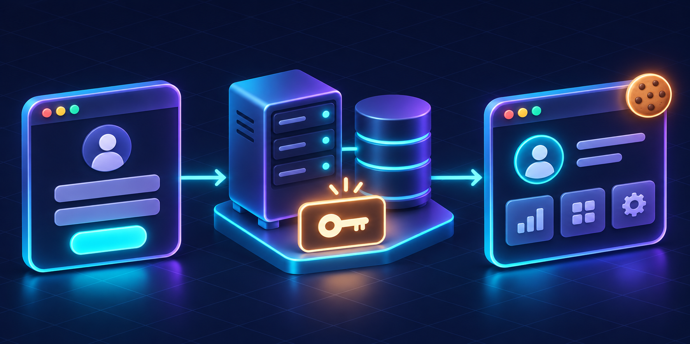
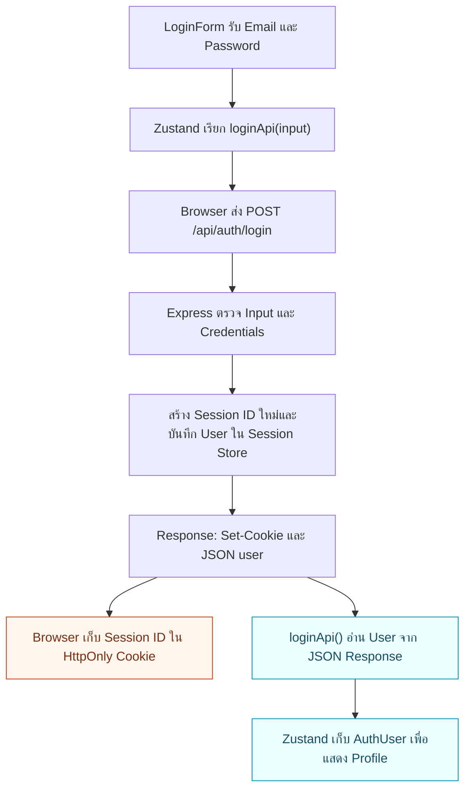
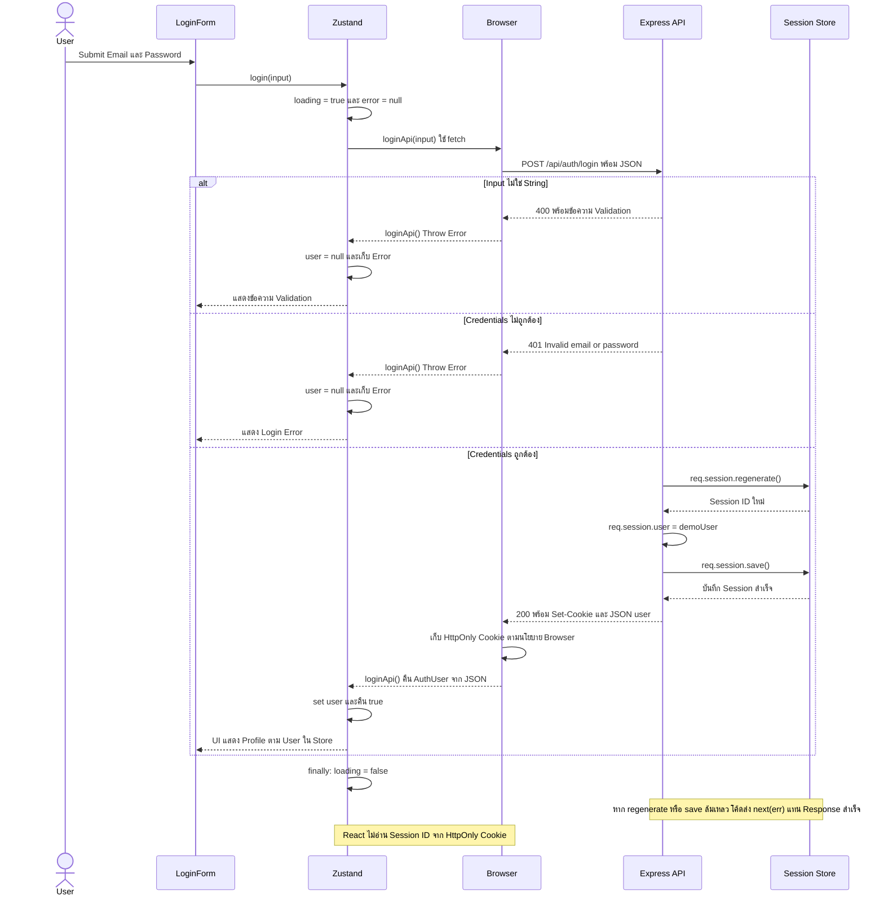
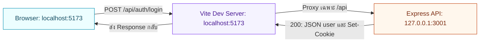

<div align="center">

  # Workshop 07.2.1: Express TypeScript & Login API

  เชื่อม React + Zustand เข้ากับ Express TypeScript  
  และสร้าง Server-side Session ผ่าน HttpOnly Cookie

  
  
  

  [← Workshop 07.1](../workshop07-01-authentication_store/README.md) · [หน้าหลัก](../../../README.md) · [Express Session Docs](https://expressjs.com/en/resources/middleware/session.html)

  <br />
  <br />

  

</div>

---

## เกี่ยวกับ Workshop

Workshop นี้ต่อจาก Workshop 07.1 โดยเปลี่ยน Mock Authentication Service ให้เป็น Backend API จริง และใช้ TypeScript ทั้ง Frontend และ Backend

| ส่วน | Technology |
| --- | --- |
| Frontend | React + TypeScript + Vite |
| State Management | Zustand |
| Backend | Node.js + Express + TypeScript |
| Development Runner | tsx |
| Authentication | Server-side Session + HttpOnly Cookie |
| Package Manager | pnpm |

เราจะใช้ `useAuthStore.ts`, `LoginForm.tsx` และ `AuthProfile.tsx` ที่สร้างเสร็จแล้วใน Workshop 07.1 ต่อ ไม่ต้องเริ่มใหม่ทั้งหมด

Workshop 07.2 แบ่งเป็นสามช่วง:

| Workshop | หัวข้อ | เป้าหมาย |
| --- | --- | --- |
| **07.2.1** | Express TypeScript + Login API | Login แล้ว Browser ได้รับ Session Cookie |
| **07.2.2** | Current User + Restore Session | Refresh แล้ว Login ยังอยู่ |
| **07.2.3** | Logout + Session Destruction | Logout แล้ว Session ฝั่ง Backend ถูกลบ |

บทนี้จะทำ **07.2.1** ให้ครบตั้งแต่ตั้งค่า Backend จน React Login สำเร็จ ส่วน `/api/auth/me` และ `/api/auth/logout` จะเพิ่มใน Workshop ถัดไป

## เป้าหมายการเรียนรู้

เมื่อจบ Workshop นี้ คุณจะสามารถ:

- อธิบายความแตกต่างระหว่าง Zustand State, Session และ Cookie ได้
- ตั้งค่า Express Backend ด้วย TypeScript และ `tsx` ได้
- เพิ่ม Type ให้ `express-session` ด้วย Module Augmentation ได้
- สร้าง Login API ที่ตรวจ Input และสร้าง Session ได้
- อธิบายหน้าที่ของ `HttpOnly`, `Secure` และ `SameSite` ได้
- ตั้งค่า Vite Proxy เพื่อเชื่อม Frontend กับ Backend ได้
- แยก HTTP Logic ไว้ใน Service และ Authentication State ไว้ใน Zustand Store ได้
- ทดสอบ Login Success, Error และ Session Cookie ผ่าน Browser DevTools ได้

## สารบัญ

1. [Authentication Architecture](#1-authentication-architecture)
2. [Cookie Attributes ที่ควรรู้](#2-cookie-attributes-ที่ควรรู้)
3. [เตรียมโครงสร้าง Backend](#3-เตรียมโครงสร้าง-backend)
4. [ติดตั้ง Dependencies](#4-ติดตั้ง-dependencies)
5. [ตั้งค่า Backend TypeScript](#5-ตั้งค่า-backend-typescript)
6. [สร้าง AuthUser Interface](#6-สร้าง-authuser-interface)
7. [สร้าง Express Server และ Login API](#7-สร้าง-express-server-และ-login-api)
8. [เปิด HTTP Server](#8-เปิด-http-server)
9. [ตั้งค่า Vite Proxy](#9-ตั้งค่า-vite-proxy)
10. [สร้าง Authentication Service](#10-สร้าง-authentication-service)
11. [เชื่อม Zustand Store กับ Backend](#11-เชื่อม-zustand-store-กับ-backend)
12. [ทดสอบระบบ](#12-ทดสอบระบบ)
13. [ผลลัพธ์ที่คาดหวัง](#13-ผลลัพธ์ที่คาดหวัง)
14. [Workshop Challenge](#14-workshop-challenge)
15. [คำถามทบทวน](#15-คำถามทบทวน)
16. [สิ่งที่ต้องส่งก่อนขึ้น Workshop 07.2.2](#สิ่งที่ต้องส่งก่อนขึ้น-workshop-0722)

---

## 1. Authentication Architecture

ใน Workshop 07.1 เราใช้ `mockLogin()` เพื่อจำลองว่า Backend ส่งข้อมูล User กลับมา แต่การ Login จริงต้องมีวิธีให้ Backend รู้ว่า Request ครั้งถัดไปมาจากผู้ใช้ที่ผ่านการยืนยันตัวตนแล้ว

Workshop นี้จะใช้ **Server-side Session**:



หลักการทำงาน:

1. Backend ตรวจสอบว่า Email และ Password ถูกต้องหรือไม่
2. Backend สร้าง Session และส่ง Session ID ให้ Browser ผ่าน `Set-Cookie`
3. Browser จัดเก็บ Session Cookie และส่งกลับไปเมื่อเรียก API ตามกฎของ Cookie
4. Zustand เก็บข้อมูล User ที่ Frontend ต้องใช้แสดงผล โดยไม่ต้องอ่าน Session ID

สำหรับ `express-session` ข้อมูล Session จะเก็บฝั่ง Server ส่วน Cookie มีเพียง Session ID ไม่ใช่ข้อมูล User ทั้งหมด

> [!IMPORTANT]
> Zustand State เป็น State สำหรับ UI ไม่ใช่หลักฐานยืนยันตัวตน Backend ต้องตรวจสอบ Session และสิทธิ์ของทุก Request ที่ต้องป้องกัน

## 2. Cookie Attributes ที่ควรรู้

ตัวอย่าง Cookie ใน Production:

```http
Set-Cookie: sid=<session-id>; HttpOnly; Secure; SameSite=Lax; Path=/
```

| Attribute | หน้าที่ |
| --- | --- |
| `HttpOnly` | ป้องกันไม่ให้ JavaScript อ่านค่า Cookie ผ่าน `document.cookie` |
| `Secure` | ส่ง Cookie ผ่าน HTTPS เท่านั้น ยกเว้นพฤติกรรมพิเศษบางอย่างของ `localhost` |
| `SameSite=Lax` | จำกัดการส่ง Cookie ใน Cross-site Request บางประเภท |
| `Path=/` | ระบุ Path ที่ Cookie ใช้งานได้ |

`HttpOnly` ช่วยลดความเสี่ยงในการขโมย Session ID ผ่าน XSS แต่ไม่ได้ทำให้แอปปลอดภัยจาก XSS หรือ CSRF ทั้งหมด อ่านเพิ่มเติมที่ [MDN: Secure cookie configuration](https://developer.mozilla.org/en-US/docs/Web/Security/Practical_implementation_guides/Cookies)

## 3. เตรียมโครงสร้าง Backend

สร้าง Folder `server` ภายใน Root ของ React Project เดิม โดยให้ Backend มี `package.json` และ `tsconfig.json` ของตัวเอง

```text
zustand-workshop/
├── server/
│   ├── src/
│   │   ├── types/
│   │   │   └── auth.ts
│   │   └── server.ts
│   ├── .env
│   ├── .gitignore
│   ├── package.json
│   └── tsconfig.json
│
├── src/
│   ├── types/
│   │   └── auth.ts
│   ├── services/
│   │   └── authService.ts
│   ├── stores/
│   │   └── useAuthStore.ts
│   └── components/
│       ├── LoginForm.tsx
│       └── AuthProfile.tsx
│
└── vite.config.ts
```

มี `auth.ts` สองไฟล์เพื่อให้ Frontend และ Backend ทำงานเป็นอิสระ แต่ทั้งสองฝั่งต้องกำหนด Data Contract ให้ตรงกัน เมื่อโปรเจกต์ใหญ่ขึ้นจึงค่อยพิจารณาสร้าง Shared Types Package

## 4. ติดตั้ง Dependencies

เปิด Terminal ที่ Root ของ React Project:

```bash
mkdir server
cd server
pnpm init
```

ติดตั้ง Runtime Dependencies:

```bash
pnpm add express express-session dotenv
```

ติดตั้ง Development Dependencies:

```bash
pnpm add -D typescript tsx @types/node @types/express @types/express-session
```

| Package | ใช้ทำอะไร |
| --- | --- |
| `express` | สร้าง HTTP Server และ Routes |
| `express-session` | จัดการ Session และ Cookie |
| `dotenv` | อ่าน Environment Variables |
| `typescript` | ตรวจ Type และ Compile TypeScript |
| `tsx` | รัน TypeScript ระหว่างพัฒนา |
| `@types/*` | เพิ่ม Type Definitions ให้ Libraries |

### ทำไมใช้ tsx?

หากใช้ `tsc` อย่างเดียว Flow จะเป็น:

```text
TypeScript → Compile → JavaScript → Node.js
```

ระหว่างพัฒนาสามารถใช้ `tsx` เพื่อรันไฟล์ `.ts` และใช้ Watch Mode เพื่อ Restart Server เมื่อแก้ไขไฟล์ได้สะดวกขึ้น

> [!IMPORTANT]
> `tsx` ไม่ได้ทำ Type Checking เต็มรูปแบบ จึงยังต้องใช้ `tsc --noEmit` ตรวจ Type แยกต่างหาก ดูรายละเอียดที่ [tsx: Type checking](https://tsx.is/typescript#type-checking)

## 5. ตั้งค่า Backend TypeScript

### 5.1 ตั้งค่า package.json

ใน `server/package.json` ให้เพิ่มหรือปรับ Fields ต่อไปนี้ โดยคง Dependencies ที่ pnpm ติดตั้งไว้:

```json
{
  "name": "zustand-auth-server",
  "private": true,
  "type": "module",
  "scripts": {
    "dev": "tsx watch src/server.ts",
    "typecheck": "tsc --noEmit",
    "build": "tsc",
    "start": "node dist/server.js"
  }
}
```

`"type": "module"` กำหนดให้โปรเจกต์ใช้ ES Modules:

```ts
import express from "express";
```

แทน CommonJS:

```js
const express = require("express");
```

### 5.2 ตั้งค่า tsconfig.json

สร้าง `server/tsconfig.json`:

```json
{
  "compilerOptions": {
    "target": "ES2022",
    "module": "NodeNext",
    "moduleResolution": "NodeNext",
    "rootDir": "./src",
    "outDir": "./dist",
    "strict": true,
    "esModuleInterop": true,
    "skipLibCheck": true
  },
  "include": ["src/**/*.ts"]
}
```

ค่าที่ควรเข้าใจ:

- `strict: true` — ตรวจ Type อย่างเข้มงวด
- `rootDir` — ตำแหน่ง Source Code
- `outDir` — ตำแหน่ง JavaScript หลัง Compile
- `NodeNext` — ใช้กฎ Module ที่สอดคล้องกับ Node.js

สำหรับการ Import ไฟล์ภายใน Backend แบบ ESM ให้ใช้ `.js` ใน Import Path เช่น `./types/auth.js` แม้ไฟล์ Source จะชื่อ `auth.ts` เพราะ TypeScript สามารถ Resolve ไฟล์ Source ได้ และ JavaScript หลัง Compile จะใช้ Path เดิม

### 5.3 สร้าง Environment Variables

สร้าง `server/.env`:

```dotenv
PORT=3001
SESSION_SECRET=replace-with-a-random-secret
```

สร้าง Secret แบบสุ่มด้วย Node.js:

```bash
node -e "console.log(require('node:crypto').randomBytes(32).toString('hex'))"
```

นำผลลัพธ์มาแทนค่า `SESSION_SECRET`

> [!WARNING]
> อย่า Commit `.env` หรือ Session Secret ลง Git และอย่าใช้ Secret ตัวอย่างใน Production

สร้าง `server/.gitignore`:

```gitignore
node_modules/
dist/
.env
```

ตอนนี้ Backend พร้อมสำหรับเริ่มเขียน TypeScript แล้ว

## 6. สร้าง AuthUser Interface

สร้างไฟล์ `server/src/types/auth.ts`:

```ts
export interface AuthUser {
  id: string;
  displayName: string;
  email: string;
  role: "USER" | "ADMIN";
}
```

นี่คือข้อมูลผู้ใช้ที่ Backend จะส่งให้ Frontend หลัง Login สำเร็จ เราไม่นำ Password ใส่ `AuthUser` เพราะ Object นี้จะถูกส่งกลับไปยัง Browser

## 7. สร้าง Express Server และ Login API

สร้างไฟล์ `server/src/server.ts` แล้วประกอบโค้ดทีละส่วน

### 7.1 Imports และ Express Application

```ts
import "dotenv/config";
import express from "express";
import session from "express-session";
import type { AuthUser } from "./types/auth.js";

const app = express();

app.use(express.json());
```

- `dotenv/config` อ่านค่า `.env` ลงใน `process.env`
- `express` สร้าง HTTP Server
- `express-session` จัดการ Session และ Cookie
- `AuthUser` กำหนด Type ของข้อมูลผู้ใช้
- `express.json()` แปลง JSON Request Body เพื่อให้เข้าถึงผ่าน `req.body`

ตัวอย่าง Request Body:

```json
{
  "email": "demo@example.com",
  "password": "workshop123"
}
```

Backend สามารถอ่านข้อมูลผ่าน `req.body.email` และ `req.body.password` แต่ข้อมูลจาก HTTP Request ต้องตรวจสอบ Type ตอน Runtime เสมอ ไม่ควรเชื่อเพียงเพราะ Frontend เขียนด้วย TypeScript

### 7.2 เพิ่ม Type ให้ SessionData

เราต้องการให้ TypeScript รองรับโค้ดนี้:

```ts
req.session.user = demoUser;
```

แต่ Type เริ่มต้นของ `SessionData` ยังไม่มี Property ชื่อ `user` ให้เพิ่ม Module Augmentation ต่อจาก Imports:

```ts
declare module "express-session" {
  interface SessionData {
    user?: AuthUser;
  }
}
```

Module Augmentation คือการเพิ่มข้อมูล Type ให้ Declaration ที่ Library มีอยู่แล้ว เครื่องหมาย `?` ระบุว่า Session อาจยังไม่มี User ก่อน Login

อ่านเพิ่มเติมที่ [TypeScript: Module Augmentation](https://www.typescriptlang.org/docs/handbook/declaration-merging.html#module-augmentation)

### 7.3 ตั้งค่า express-session

เพิ่มโค้ดต่อจาก `app.use(express.json())`:

```ts
const sessionSecret = process.env.SESSION_SECRET;

if (!sessionSecret) {
  throw new Error("SESSION_SECRET is required");
}

app.use(
  session({
    name: "workshop.sid",
    secret: sessionSecret,
    resave: false,
    saveUninitialized: false,
    cookie: {
      httpOnly: true,
      secure: false,
      sameSite: "lax",
      maxAge: 30 * 60 * 1000,
    },
  }),
);
```

| Option | หน้าที่ |
| --- | --- |
| `name` | ชื่อ Session Cookie |
| `secret` | Key ที่ใช้ลงลายเซ็น Session ID Cookie |
| `resave: false` | ไม่บังคับบันทึก Session ใหม่ทุก Request หากไม่มีการเปลี่ยนแปลง |
| `saveUninitialized: false` | ไม่บันทึก Session ใหม่ที่ยังไม่มีการเปลี่ยนแปลง |
| `httpOnly: true` | ไม่ให้ JavaScript อ่าน Cookie |
| `secure: false` | ใช้สำหรับ Workshop บน HTTP localhost เท่านั้น |
| `sameSite: "lax"` | จำกัดการส่ง Cookie แบบ Cross-site |
| `maxAge` | กำหนดอายุ Cookie เป็น 30 นาที |

> [!WARNING]
> `secure: false` ใช้สำหรับทดลองบน HTTP localhost เท่านั้น Production ต้องใช้ HTTPS และ Secure Cookie

> [!IMPORTANT]
> `express-session` ใช้ `MemoryStore` เป็นค่าเริ่มต้น ซึ่งไม่เหมาะกับ Production และ Session จะหายเมื่อ Restart Backend ระบบจริงต้องใช้ Session Store ที่เหมาะสม ดูรายละเอียดที่ [Express Session: Warning](https://expressjs.com/en/resources/middleware/session.html#warning-the-default-server-side-session-storage-memorystore-is-purposely-not-designed-for-a-production-environment)

### 7.4 สร้าง POST Login API

กำหนด Demo User:

```ts
const demoUser: AuthUser = {
  id: "user001",
  displayName: "Demo User",
  email: "demo@example.com",
  role: "USER",
};
```

เพิ่ม Login Route:

```ts
app.post("/api/auth/login", (req, res, next) => {
  const email: unknown = req.body?.email;
  const password: unknown = req.body?.password;

  // 1. ตรวจสอบชนิดข้อมูล
  if (
    typeof email !== "string" ||
    typeof password !== "string"
  ) {
    return res.status(400).json({
      message: "Email and password must be strings",
    });
  }

  // 2. ตรวจสอบบัญชี Demo
  if (
    email !== "demo@example.com" ||
    password !== "workshop123"
  ) {
    return res.status(401).json({
      message: "Invalid email or password",
    });
  }

  // 3. สร้าง Session ID ใหม่
  req.session.regenerate((err) => {
    if (err) return next(err);

    // 4. เก็บข้อมูล User ฝั่ง Backend
    req.session.user = demoUser;

    // 5. บันทึก Session
    req.session.save((saveErr) => {
      if (saveErr) return next(saveErr);

      // 6. ส่งเฉพาะ User กลับ Frontend
      return res.status(200).json({
        user: demoUser,
      });
    });
  });
});
```

> [!CAUTION]
> บัญชีทดสอบแบบ Hardcoded ใช้เพื่อเรียนรู้เท่านั้น ไม่ใช่ระบบ Login ที่ปลอดภัยสำหรับ Production ระบบจริงต้องใช้ฐานข้อมูล Password Hash, Rate Limiting และมาตรการป้องกันการเดารหัสผ่าน

### ทำความเข้าใจ req.session.regenerate()

```ts
req.session.regenerate((err) => {
  // สร้าง Session ID ใหม่ แล้วจึงเก็บข้อมูล User
});
```

เมื่อ Login สำเร็จ `regenerate()` จะสร้าง Session ID ใหม่เพื่อลดความเสี่ยง Session Fixation จากนั้นจึงเก็บ:

```ts
req.session.user = demoUser;
```

นี่คือ Server-side State ไม่ใช่ Zustand State ข้อมูล User อยู่ใน Session Store ของ Backend ส่วน Browser ได้รับ Cookie ที่มี Session ID

### ทำความเข้าใจ req.session.save()

```ts
req.session.save((saveErr) => {
  if (saveErr) return next(saveErr);

  return res.json({ user: demoUser });
});
```

โค้ดนี้บันทึกข้อมูล Session ให้สำเร็จก่อนส่ง Response กลับ Frontend เพื่อให้ Request ถัดไปค้นหา Session ได้

### ลำดับ Request และ Response ของ Login

แผนภาพนี้แสดงการแยกผลลัพธ์ `400`, `401` และ `200` ตาม Login Route ในบทนี้ โดยกรณีสำเร็จจะบันทึก Session ก่อนตอบ Response:



## 8. เปิด HTTP Server

เพิ่มท้ายไฟล์ `server.ts`:

```ts
const port = Number(process.env.PORT ?? 3001);

app.listen(port, "127.0.0.1", () => {
  console.log(`Server running at http://127.0.0.1:${port}`);
});
```

ตอนนี้ `server.ts` มี Imports, Session Type, Middleware, Login Route และ `app.listen()` ครบแล้ว

ตรวจ TypeScript:

```bash
pnpm typecheck
```

จากนั้นรัน Backend:

```bash
pnpm dev
```

ผลลัพธ์ที่คาดหวัง:

```text
Server running at http://127.0.0.1:3001
```

ตอนนี้ Backend ทำงานสามอย่าง:

1. รับ Email และ Password
2. ตรวจสอบข้อมูลและสร้าง Session
3. ส่ง User กลับ Frontend พร้อม Session Cookie

ยังไม่มี `/api/auth/me` หรือ `/api/auth/logout` ซึ่งจะเพิ่มใน Workshop ถัดไป

## 9. ตั้งค่า Vite Proxy

ตอนนี้มี Server สองตัว:

| Server | Port | หน้าที่ |
| --- | --- | --- |
| React Vite | `5173` | Frontend |
| Express API | `3001` | Backend |

เราจะใช้ Vite Proxy เพื่อให้ Browser เรียก API ผ่าน Origin เดียวกับ React แล้วให้ Vite ส่ง Request ต่อไปยัง Backend

เปิด `vite.config.ts` ฝั่ง React และเพิ่ม `server.proxy`:

```ts
import { defineConfig } from "vite";
import react from "@vitejs/plugin-react";

export default defineConfig({
  plugins: [react()],
  server: {
    proxy: {
      "/api": {
        target: "http://127.0.0.1:3001",
        changeOrigin: true,
      },
    },
  },
});
```

หากโปรเจกต์เดิมมี Plugins หรือ Options อื่น ให้คงไว้และเพิ่มเฉพาะ `server.proxy`



ภาพนี้แสดงเส้นทาง Request และ Response เมื่อ Login สำเร็จใน Development Browser เรียก `localhost:5173` ส่วน Vite เป็นผู้ส่ง Request ต่อไปยัง Express ที่ `127.0.0.1:3001`

React จึงเรียก `/api/auth/login` ได้โดยไม่ต้องระบุ `http://127.0.0.1:3001` โดยตรง และ Browser เห็น API เป็น Same-origin จึงไม่ต้องตั้งค่า Cross-origin CORS สำหรับ Flow นี้

> [!IMPORTANT]
> ระหว่าง Workshop ให้เปิด React ด้วย `http://localhost:5173` อย่างสม่ำเสมอ อย่าสลับกับ `127.0.0.1` เพราะ Cookie ผูกกับ Host

อ่านเพิ่มเติมที่ [Vite: Server proxy](https://vite.dev/config/server-options.html#server-proxy)

ภาพเปิดบทและไฟล์ต้นฉบับ Diagram เก็บอยู่ใน `assets-repo`:

- [ภาพ Express Login API](../../../assets-repo/images/workshop07-02a-express-login-hero.png)
- [Flowchart: Session, Cookie และ Zustand](../../../assets-repo/diagrams/workshop07-02a-session-architecture.mmd)
- [Sequence Diagram: Login API](../../../assets-repo/diagrams/workshop07-02a-login-sequence.mmd)
- [Flowchart: Vite Proxy](../../../assets-repo/diagrams/workshop07-02a-vite-proxy-flow.mmd)

Mermaid จะแสดงเป็นแผนภาพบน GitHub และ Markdown Viewer ที่รองรับ ส่วนไฟล์ `.mmd` สามารถนำไปแก้ไขหรือ Export เป็นภาพต่อได้

## 10. สร้าง Authentication Service

สร้างไฟล์ `src/services/authService.ts` ภายใน React Project โดยใช้ `AuthUser` และ `LoginInput` จาก Workshop 07.1:

```ts
import type { AuthUser, LoginInput } from "../types/auth";

interface LoginResponse {
  user: AuthUser;
}

interface ApiErrorResponse {
  message?: string;
}

export async function loginApi(
  input: LoginInput,
): Promise<AuthUser> {
  const response = await fetch("/api/auth/login", {
    method: "POST",
    headers: {
      "Content-Type": "application/json",
    },
    credentials: "include",
    body: JSON.stringify(input),
  });

  if (!response.ok) {
    const errorData: ApiErrorResponse = await response.json();

    throw new Error(errorData.message ?? "Login failed");
  }

  const data: LoginResponse = await response.json();

  return data.user;
}
```

โค้ดนี้คาดว่า Backend จะตอบ JSON ตาม Contract ที่กำหนดไว้ ระบบจริงควรตรวจสอบ Response ตอน Runtime และรองรับกรณี Response ไม่ใช่ JSON เพิ่มเติม

### ทำไมใช้ credentials: "include"?

```ts
credentials: "include"
```

Option นี้กำหนดให้ Fetch รองรับการส่ง Credentials เช่น Cookie และรับ `Set-Cookie` ตามนโยบายของ Browser สำหรับ Same-origin ค่าเริ่มต้น `same-origin` ก็เพียงพอ แต่ระบุ `include` เพื่อสื่อเจตนาเรื่อง Cookie ให้ชัดเจน

หากภายหลังเรียก API แบบ Cross-origin จะต้องตั้งค่า CORS และ Cookie Attributes ให้สอดคล้องกัน อ่านเพิ่มเติมที่ [MDN: Including credentials](https://developer.mozilla.org/en-US/docs/Web/API/Fetch_API/Using_Fetch#including_credentials)

### ทำไม LoginResponse มี user?

เพราะ Backend ส่ง Response รูปแบบนี้:

```json
{
  "user": {
    "id": "user001",
    "displayName": "Demo User",
    "email": "demo@example.com",
    "role": "USER"
  }
}
```

Frontend จึงต้องอ่าน `data.user` เพื่อให้ได้ Object ที่ตรงกับ `AuthUser` Response ไม่มี Session ID ให้ React อ่าน เพราะ Browser เป็นผู้จัดการ HttpOnly Cookie

## 11. เชื่อม Zustand Store กับ Backend

ใน Workshop 07.1 เรา Import Mock Service:

```ts
import { mockLogin } from "../services/mockAuth";
```

เปลี่ยนเป็น:

```ts
import { loginApi } from "../services/authService";
```

จากนั้นเปลี่ยน Login Action ให้เรียก `loginApi(input)`:

```ts
login: async (input) => {
  set({ loading: true, error: null });

  try {
    const user = await loginApi(input);

    set({ user });

    return true;
  } catch (error) {
    set({
      user: null,
      error:
        error instanceof Error
          ? error.message
          : "Login failed",
    });

    return false;
  } finally {
    set({ loading: false });
  }
},
```

เรายังใช้ `Promise<boolean>` เหมือน Workshop ก่อนหน้า เพื่อให้ Component ทราบผลลัพธ์และนำไปใช้กับ Navigation ในภายหลัง

> [!WARNING]
> `logout()` ในขั้นนี้ล้างเพียง Zustand State ยังไม่ได้ทำลาย Session ฝั่ง Backend การ Logout ที่สมบูรณ์จะเพิ่มใน Workshop 07.2.3

### ทำไมไม่เขียน fetch() ใน Store โดยตรง?

การแยกหน้าที่ทำให้โค้ดดูแลและทดสอบง่ายขึ้น:

| ส่วน | ความรับผิดชอบ |
| --- | --- |
| `authService.ts` | ส่ง HTTP Request และตรวจ Response |
| `useAuthStore.ts` | จัดการ User, Loading และ Error |
| `LoginForm.tsx` | รับข้อมูลและเรียก Action |
| `AuthProfile.tsx` | แสดงข้อมูลจาก Store |

## 12. ทดสอบระบบ

เปิด Backend และ Frontend พร้อมกันจากคนละ Working Directory

### Terminal 1 — Backend

```bash
cd server
pnpm dev
```

### Terminal 2 — React

```bash
pnpm dev
```

ใช้บัญชีทดสอบ:

| Field | Value |
| --- | --- |
| Email | `demo@example.com` |
| Password | `workshop123` |

เมื่อ Login สำเร็จควรได้ HTTP `200` และ Zustand จะเก็บข้อมูล User ที่ Backend ส่งกลับมา

### ตรวจสอบ Cookie ผ่าน DevTools

1. เปิด Chrome DevTools → **Network**
2. เลือก Request `login`
3. ตรวจ Response Headers ว่ามี `Set-Cookie`
4. เปิด **Application** → **Cookies** → `http://localhost:5173`
5. ตรวจว่ามี Cookie ชื่อ `workshop.sid` และ Attribute `HttpOnly`

> [!CAUTION]
> อย่าส่งค่าจริงของ Session Cookie มาในแชทหรือ Screenshot ที่เผยแพร่ เพราะ Session ID เป็นข้อมูลลับ

## 13. ผลลัพธ์ที่คาดหวัง

| กรณี | HTTP | ผลลัพธ์ |
| --- | --- | --- |
| Email และ Password ถูกต้อง | `200` | Login สำเร็จและมี Session Cookie |
| Password ผิด | `401` | แสดง `Invalid email or password` |
| Request Body ไม่ตรง Type ที่กำหนด | `400` | แจ้งให้ส่ง Email/Password เป็น String |
| Refresh หลัง Login | — | UI กลับสู่สถานะเริ่มต้น เพราะยังไม่มี `/api/auth/me` |
| กด Logout ตอนนี้ | — | ล้าง User ใน Zustand เท่านั้น Session ฝั่ง Backend ยังอยู่ |

## 14. Workshop Challenge

ลงมือสร้าง Flow Login ด้วย TypeScript ทั้ง Frontend และ Backend โดยยังไม่ต้องเพิ่ม API อื่น

### ภารกิจที่ต้องทำ

**ความคืบหน้า: 8/8**

- [x] ติดตั้ง Express + TypeScript + tsx และ Types ที่จำเป็น
- [x] ตั้งค่า `package.json`, `tsconfig.json` และ `.env`
- [x] สร้าง `AuthUser` Interface ฝั่ง Backend
- [x] เพิ่ม `SessionData` Type ด้วย Module Augmentation
- [x] สร้าง `POST /api/auth/login` และ Session Cookie
- [x] ตั้งค่า Vite Proxy และ `authService.ts`
- [x] เปลี่ยน `useAuthStore` ให้เรียก `loginApi`
- [x] ทดสอบ Login Success, Error และตรวจ Session Cookie

## 15. คำถามทบทวน

### 1. ทำไมเราต้องใช้ declare module "express-session"?

- A. เพื่อเพิ่ม Property `user` ให้ `SessionData` ที่ TypeScript รู้จัก
- B. เพื่อสร้าง HTTP Route
- C. เพื่อเปิดใช้งาน `localStorage`

<details>
<summary><strong>ดูคำตอบ</strong></summary>

**คำตอบ: A** — Module Augmentation เพิ่ม Type ของ `user` ให้ Interface `SessionData` ที่ Library ประกาศไว้แล้ว

</details>

### 2. ทำไมหลัง Login สำเร็จต้องใช้ req.session.regenerate()?

- A. เพื่อแปลง JSON
- B. เพื่อสร้าง Session ID ใหม่และลดความเสี่ยง Session Fixation
- C. เพื่อ Reset Zustand

<details>
<summary><strong>ดูคำตอบ</strong></summary>

**คำตอบ: B** — การสร้าง Session ID ใหม่หลังยืนยันตัวตนช่วยลดความเสี่ยงจากการใช้ Session ID เดิมที่ผู้โจมตีอาจรู้ล่วงหน้า

</details>

### 3. ทำไม React ไม่ต้องอ่านค่า Session ID โดยตรง?

- A. เพราะ Browser จัดการ HttpOnly Cookie และส่งกลับตามกฎของ Cookie
- B. เพราะ Session ID ถูกเก็บใน Zustand อัตโนมัติ
- C. เพราะ Express ไม่ใช้ Cookie

<details>
<summary><strong>ดูคำตอบ</strong></summary>

**คำตอบ: A** — Browser จัดเก็บและส่ง HttpOnly Cookie โดย React ไม่สามารถและไม่จำเป็นต้องอ่าน Session ID

</details>

## สิ่งที่ต้องส่งก่อนขึ้น Workshop 07.2.2

1. `server/src/server.ts` — Express Server, Session และ Login Route
2. `server/src/types/auth.ts` — `AuthUser` ฝั่ง Backend
3. `server/tsconfig.json` — TypeScript Configuration
4. `src/services/authService.ts` — Login API Service
5. `src/stores/useAuthStore.ts` — Login Action ที่เชื่อม Backend
6. คำตอบของคำถามทบทวนทั้งสามข้อ

สิ่งที่จะตรวจ:

- TypeScript Configuration และ ESM Import
- `SessionData` Module Augmentation
- Input Validation และ HTTP Status ของ Login API
- การสร้างและบันทึก Session
- Async Action และ State Lifecycle ของ Zustand
- การเชื่อม Frontend กับ Backend ผ่าน Vite Proxy

Workshop 07.2.2 จะเพิ่ม `GET /api/auth/me` เพื่อให้ React ตรวจสอบ Session เดิมและ Restore Authentication State หลัง Refresh

## แหล่งข้อมูลเพิ่มเติม

- [Express Session](https://expressjs.com/en/resources/middleware/session.html)
- [TypeScript: Declaration Merging](https://www.typescriptlang.org/docs/handbook/declaration-merging.html)
- [Vite: Server proxy](https://vite.dev/config/server-options.html#server-proxy)
- [MDN: Using the Fetch API](https://developer.mozilla.org/en-US/docs/Web/API/Fetch_API/Using_Fetch)
- [MDN: Secure cookie configuration](https://developer.mozilla.org/en-US/docs/Web/Security/Practical_implementation_guides/Cookies)

---

<div align="center">

  **ถัดไป:** [Workshop 07.2.2 — Restore Authentication Session](../workshop07-02b-restore_authentication_session/README.md)

  [← Workshop 07.1](../workshop07-01-authentication_store/README.md) · [กลับสู่หน้าหลัก](../../../README.md)

</div>
