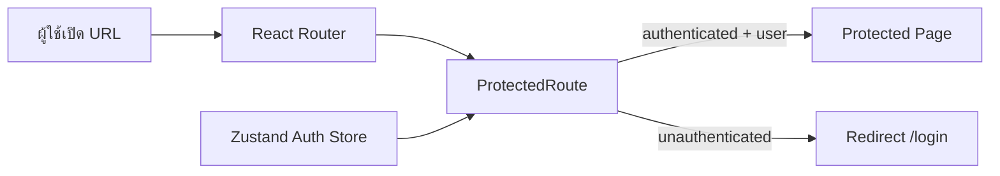
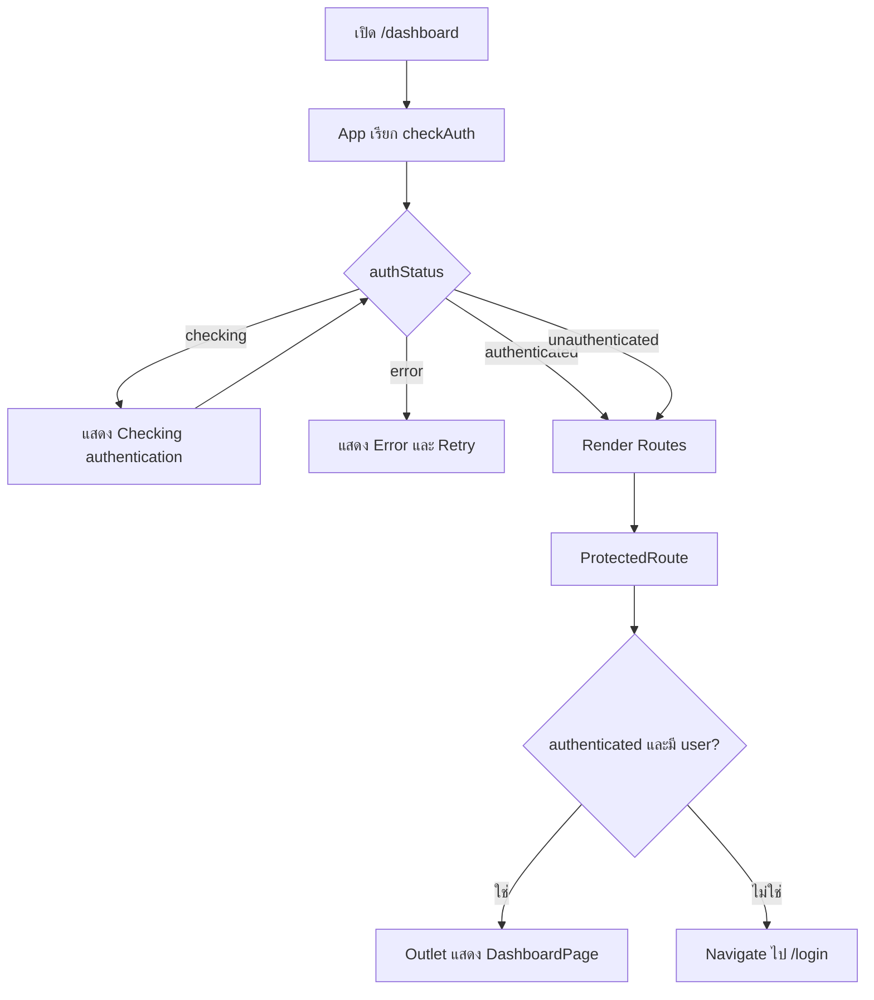
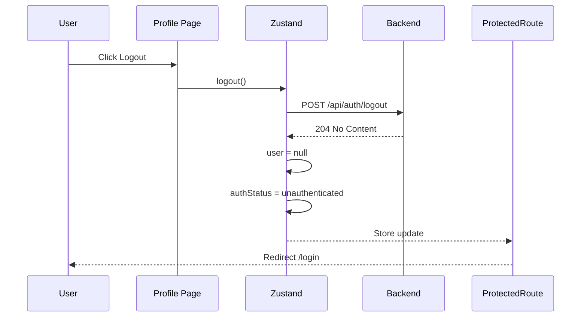

<div align="center">

  # Workshop 07.3.1: Protected Routes

  ควบคุมการเข้าถึงหน้าด้วย React Router  
  และ Authentication State จาก Zustand

  
  
  

  [← Workshop 07.2.3](../workshop07-02c-logout_session_destruction/README.md) · [หน้าหลัก](../../../README.md) · [React Router Docs](https://reactrouter.com/start/declarative/routing)

  <br />
  <br />

  

</div>

---

## เกี่ยวกับ Workshop

หลังจาก Workshop 07.2 ระบบ Authentication สามารถ Login, Restore Session หลัง Refresh และ Logout ผ่าน Backend ได้แล้ว ขั้นต่อไปคือใช้ React Router ควบคุมว่าผู้ใช้แต่ละสถานะสามารถเปิดหน้าใดได้บ้าง

ตัวอย่างเช่น Guest ไม่ควรเปิด `/dashboard` หรือ `/profile` ได้ แต่ผู้ใช้ที่ Login แล้วควรเข้าถึงหน้าเหล่านี้และ Refresh URL เดิมได้โดยไม่ถูกส่งกลับหน้า Login

Workshop 07.3 แบ่งเป็นสี่ช่วง:

| Workshop | หัวข้อ | สิ่งที่จะฝึก |
| --- | --- | --- |
| **07.3.1 ← บทนี้** | Protected Routes | ป้องกัน Dashboard และ Profile สำหรับ Guest |
| **07.3.2** | Role-based Routes | แยกสิทธิ์ `USER` และ `ADMIN` |
| **07.3.3** | Navigation & Redirect | กลับไปหน้าที่ผู้ใช้ต้องการหลัง Login |
| **07.3.4** | Backend Authorization | ตรวจสิทธิ์ใน Protected API จริง |

บทนี้จะเริ่มจาก **07.3.1** โดยใช้ React Router แบบ Declarative ผ่าน `<BrowserRouter>`, `<Routes>` และ `<Route>` เพื่อให้เห็นความสัมพันธ์ระหว่าง URL, Authentication State และ UI อย่างชัดเจน

## เป้าหมายการเรียนรู้

เมื่อจบ Workshop นี้ คุณจะสามารถ:

- อธิบายหน้าที่ของ Protected Route ได้
- แยกขอบเขตความรับผิดชอบของ React Router และ Zustand ได้
- ติดตั้งและตั้งค่า `<BrowserRouter>` ได้
- สร้าง Page Components สำหรับ Router ได้
- Redirect ผู้ใช้ด้วย `<Navigate>` ได้
- สร้าง Route Guard ที่ใช้ `<Outlet>` ได้
- จัด Protected Routes ด้วย Nested Routes ได้
- ป้องกัน Authentication Redirect Flash ระหว่าง Restore Session ได้
- ทดสอบ Navigation, Refresh, Logout และ 404 Route ได้
- อธิบายได้ว่าการป้องกัน Route ฝั่ง React ไม่ใช่ Backend Authorization

## สารบัญ

1. [Protected Route คืออะไร?](#1-protected-route-คืออะไร)
2. [ติดตั้งและตั้งค่า React Router](#2-ติดตั้งและตั้งค่า-react-router)
3. [สร้าง Pages สำหรับ Router](#3-สร้าง-pages-สำหรับ-router)
4. [สร้าง ProtectedRoute](#4-สร้าง-protectedroute)
5. [ประกอบ Routes ใน App](#5-ประกอบ-routes-ใน-app)
6. [ทำความเข้าใจ Routing Flow](#6-ทำความเข้าใจ-routing-flow)
7. [ทดสอบ Protected Routes](#7-ทดสอบ-protected-routes)
8. [ข้อควรรู้เมื่อนำ SPA ขึ้น Production](#8-ข้อควรรู้เมื่อนำ-spa-ขึ้น-production)
9. [Workshop Challenge](#9-workshop-challenge)
10. [คำถามทบทวน](#10-คำถามทบทวน)
11. [สิ่งที่ต้องส่งก่อนขึ้น Workshop 07.3.2](#สิ่งที่ต้องส่งก่อนขึ้น-workshop-0732)

---

## 1. Protected Route คืออะไร?

Protected Route คือ Component ที่ตรวจ Authentication State ก่อนอนุญาตให้แสดง Page ที่ผู้ใช้ร้องขอ

| Route | ผู้ที่เข้าถึงได้ | พฤติกรรมเมื่อไม่ผ่าน |
| --- | --- | --- |
| `/login` | Guest | ผู้ใช้ที่ Login แล้วถูกส่งไป `/dashboard` |
| `/dashboard` | ผู้ใช้ที่ Login แล้ว | Redirect ไป `/login` |
| `/profile` | ผู้ใช้ที่ Login แล้ว | Redirect ไป `/login` |
| `/admin` | ADMIN | เรียนต่อใน Workshop 07.3.2 |

React Router และ Zustand มีหน้าที่ต่างกัน:

| ส่วน | ความรับผิดชอบ |
| --- | --- |
| React Router | จัดการ URL, Route Matching, Navigation และ Redirect |
| Zustand | เก็บ `user`, `authStatus` และ Authentication Actions |
| Express Backend | ตรวจ Session และสิทธิ์ของ API Requests |



> [!IMPORTANT]
> Protected Route ฝั่ง React ป้องกันการแสดง UI เท่านั้น ผู้ใช้ยังสามารถเรียก API โดยตรงได้ Backend จึงต้องตรวจ Session และ Authorization ในทุก Protected Endpoint เสมอ

## 2. ติดตั้งและตั้งค่า React Router

Workshop นี้ใช้ React Router **Declarative Mode** ซึ่งเหมาะกับการเรียน Routing พื้นฐานด้วย JSX Routes

### 2.1 ติดตั้ง Package

จาก Root ของ Frontend Project:

```bash
pnpm add react-router
```

React Router รุ่นปัจจุบันรองรับการ Import Declarative APIs จาก `react-router` โดยตรง ดูรายละเอียดที่ [React Router: Declarative Installation](https://reactrouter.com/start/declarative/installation)

### 2.2 โครงสร้างไฟล์

```text
src/
├── components/
│   ├── AuthProfile.tsx
│   └── LoginForm.tsx
├── pages/
│   ├── DashboardPage.tsx
│   └── LoginPage.tsx
├── routes/
│   └── ProtectedRoute.tsx
├── services/
│   └── authService.ts
├── stores/
│   └── useAuthStore.ts
├── App.tsx
└── main.tsx
```

Backend Express TypeScript ยังคงใช้ Login, Current User และ Logout APIs จาก Workshop 07.2 โดยไม่ต้องแก้ไขในบทนี้

### 2.3 ครอบ App ด้วย BrowserRouter

แก้ `src/main.tsx`:

```tsx
import { StrictMode } from "react";
import { createRoot } from "react-dom/client";
import { BrowserRouter } from "react-router";
import App from "./App";

createRoot(document.getElementById("root")!).render(
  <StrictMode>
    <BrowserRouter>
      <App />
    </BrowserRouter>
  </StrictMode>,
);
```

`BrowserRouter` ใช้ Browser History API สำหรับ Client-side Routing และสร้าง Router Context ให้ Components ภายในใช้ `<Routes>`, `<Navigate>`, `<Link>` และ Router Hooks ได้

> [!WARNING]
> อย่าครอบ `<BrowserRouter>` ซ้ำหากโปรเจกต์มี Router อยู่แล้ว และอย่าเรียก Router APIs นอก Router Context

## 3. สร้าง Pages สำหรับ Router

### 3.1 สร้าง DashboardPage

สร้าง `src/pages/DashboardPage.tsx`:

```tsx
import { Link } from "react-router";
import { useAuthStore } from "../stores/useAuthStore";

export default function DashboardPage() {
  const user = useAuthStore((state) => state.user);

  return (
    <main>
      <h1>Dashboard</h1>
      <p>Welcome, {user?.displayName}</p>

      <nav>
        <Link to="/profile">My Profile</Link>
      </nav>
    </main>
  );
}
```

Component นี้ใช้แนวคิดเดิมสองเรื่อง:

- Zustand Selector เลือก User จาก Authentication Store
- `<Link>` เปลี่ยน URL ภายใน SPA โดยไม่ Reload เอกสารเว็บทั้งหน้า

อ่านเพิ่มเติมที่ [React Router: Linking](https://reactrouter.com/start/declarative/routing#linking)

### 3.2 สร้าง LoginPage

สร้าง `src/pages/LoginPage.tsx`:

```tsx
import { Navigate } from "react-router";
import LoginForm from "../components/LoginForm";
import { useAuthStore } from "../stores/useAuthStore";

export default function LoginPage() {
  const user = useAuthStore((state) => state.user);

  if (user) {
    return <Navigate to="/dashboard" replace />;
  }

  return <LoginForm />;
}
```

`LoginPage` และ `LoginForm` แยกหน้าที่กัน:

| Component | หน้าที่ |
| --- | --- |
| `LoginForm` | รับ Email/Password และเรียก `login()` |
| `LoginPage` | เลือกว่าจะแสดง Form หรือ Redirect |

เมื่อ Login สำเร็จ Zustand เปลี่ยน `user` จาก `null` เป็น `AuthUser` ทำให้ `LoginPage` Re-render และแสดง `<Navigate>`

### ทำไมใช้ replace?

```tsx
<Navigate to="/dashboard" replace />
```

`replace` แทนที่ History Entry ปัจจุบันแทนการเพิ่ม Entry ใหม่ หลัง Login ผู้ใช้จึงไม่จำเป็นต้องย้อนกลับไปยัง `/login` ที่เพิ่งใช้งาน

## 4. สร้าง ProtectedRoute

เมื่อผู้ใช้พิมพ์ `/dashboard` โดยตรง เราต้องตัดสินใจตามลำดับนี้:

1. Backend ตรวจสอบ Session เสร็จหรือยัง
2. Authentication สำเร็จหรือไม่
3. หากไม่ผ่าน ให้ Redirect ไป `/login`
4. หากผ่าน ให้แสดง Page ที่ร้องขอ

ข้อมูลที่ใช้ตัดสินใจมีอยู่ใน Zustand แล้ว:

```ts
user: AuthUser | null;
authStatus: AuthStatus;
```

### 4.1 เขียน ProtectedRoute.tsx

สร้าง `src/routes/ProtectedRoute.tsx`:

```tsx
import { Navigate, Outlet } from "react-router";
import { useAuthStore } from "../stores/useAuthStore";

export default function ProtectedRoute() {
  const user = useAuthStore((state) => state.user);
  const authStatus = useAuthStore((state) => state.authStatus);

  if (authStatus !== "authenticated" || !user) {
    return <Navigate to="/login" replace />;
  }

  return <Outlet />;
}
```

### 4.2 ตรวจ Authentication State

```tsx
if (authStatus !== "authenticated" || !user) {
  return <Navigate to="/login" replace />;
}
```

เครื่องหมาย `||` หมายถึง OR หากเงื่อนไขใดเงื่อนไขหนึ่งเป็นจริง Route จะ Redirect

| authStatus | user | ผลลัพธ์ |
| --- | --- | --- |
| `authenticated` | `AuthUser` | อนุญาต |
| `authenticated` | `null` | Redirect |
| `unauthenticated` | `null` | Redirect |
| `checking` | `null` | App แสดง Loading ก่อน Router |
| `error` | `null` | App แสดง Error ก่อน Router |

### 4.3 Outlet คืออะไร?

```tsx
return <Outlet />;
```

`<Outlet>` คือจุดที่ React Router นำ Element ของ Child Route มาแสดง เมื่อใช้ ProtectedRoute เป็น Layout Route เราจึงใช้ Guard เดียวกับ Protected Pages หลายหน้าได้

```tsx
<Route element={<ProtectedRoute />}>
  <Route path="/dashboard" element={<DashboardPage />} />
  <Route path="/profile" element={<AuthProfile />} />
</Route>
```

นี่คือ Nested/Layout Route: Parent Route ไม่มี `path` แต่เพิ่ม Logic ครอบ Child Routes โดยไม่เพิ่ม Segment ให้ URL

## 5. ประกอบ Routes ใน App

เปิด `src/App.tsx` แล้วคง `checkAuth()` จาก Workshop 07.2.2 ไว้ จากนั้นเปลี่ยนส่วนแสดงผลให้ใช้ Routes:

```tsx
import { useEffect } from "react";
import { Navigate, Route, Routes } from "react-router";
import AuthProfile from "./components/AuthProfile";
import DashboardPage from "./pages/DashboardPage";
import LoginPage from "./pages/LoginPage";
import ProtectedRoute from "./routes/ProtectedRoute";
import { useAuthStore } from "./stores/useAuthStore";

export default function App() {
  const authStatus = useAuthStore((state) => state.authStatus);
  const error = useAuthStore((state) => state.error);
  const checkAuth = useAuthStore((state) => state.checkAuth);

  useEffect(() => {
    void checkAuth();
  }, [checkAuth]);

  if (authStatus === "checking") {
    return <p>Checking authentication...</p>;
  }

  if (authStatus === "error") {
    return (
      <div>
        <p>Session verification failed: {error}</p>
        <button onClick={() => void checkAuth()}>
          Retry Authentication
        </button>
      </div>
    );
  }

  return (
    <Routes>
      <Route
        path="/"
        element={<Navigate to="/dashboard" replace />}
      />

      <Route path="/login" element={<LoginPage />} />

      <Route element={<ProtectedRoute />}>
        <Route
          path="/dashboard"
          element={<DashboardPage />}
        />
        <Route
          path="/profile"
          element={<AuthProfile />}
        />
      </Route>

      <Route path="*" element={<h2>404 Not Found</h2>} />
    </Routes>
  );
}
```

ลำดับ Routes มีความหมายดังนี้:

| Route | Element |
| --- | --- |
| `/` | Redirect ไป `/dashboard` |
| `/login` | `LoginPage` |
| `/dashboard` | `DashboardPage` ผ่าน `ProtectedRoute` |
| `/profile` | `AuthProfile` ผ่าน `ProtectedRoute` |
| `*` | หน้า 404 สำหรับ URL ที่ไม่ตรง Route ใด |

## 6. ทำความเข้าใจ Routing Flow

### 6.1 เปิด Protected URL โดยตรง



### ทำไม App ต้องตรวจ authStatus ก่อน Routes?

App ต้องรอ `GET /api/auth/me` ทำงานเสร็จก่อน หาก Router ตัดสินใจตอน `user` ยังเป็น `null` ผู้ใช้ที่มี Session ถูกต้องอาจถูก Redirect ไป `/login` ชั่วคราว ปัญหานี้เรียกว่า **Authentication Redirect Flash**

### 6.2 หลัง Logout



ไม่ต้องเพิ่ม Navigation ใน `logout()` เพราะ ProtectedRoute Subscribe Authentication State อยู่แล้ว เมื่อ State เปลี่ยน Route Guard จะ Re-render และ Redirect โดยอัตโนมัติ

## 7. ทดสอบ Protected Routes

เปิด Backend และ Frontend:

```bash
# Terminal 1
cd server
pnpm dev

# Terminal 2 — Project Root
pnpm dev
```

ทดสอบสถานการณ์ต่อไปนี้:

| สถานการณ์ | ผลลัพธ์ที่คาดหวัง |
| --- | --- |
| ยังไม่ Login แล้วเปิด `/dashboard` | Redirect ไป `/login` |
| ยังไม่ Login แล้วเปิด `/profile` | Redirect ไป `/login` |
| Login สำเร็จ | Redirect ไป `/dashboard` |
| Login แล้วเปิด `/profile` | แสดง `AuthProfile` |
| Refresh บน `/profile` | ตรวจ Session แล้วกลับมาแสดง `AuthProfile` |
| Logout จาก `/profile` | Redirect ไป `/login` |
| Login แล้วเปิด `/login` | Redirect ไป `/dashboard` |
| เปิด `/unknown` | แสดง `404 Not Found` |

### Checklist

- [ ] Guest เข้า Protected Routes ไม่ได้
- [ ] Login แล้วเข้าถึง Dashboard และ Profile ได้
- [ ] Refresh Protected URL แล้วไม่หลุด Login
- [ ] Logout แล้วกลับไปหน้า Login
- [ ] กด Back หลัง Logout แล้วไม่เห็น Protected Content
- [ ] Unknown Route แสดงหน้า 404

## 8. ข้อควรรู้เมื่อนำ SPA ขึ้น Production

เมื่อ Deploy React SPA บน IIS, Nginx, Apache หรือ Static Host การเปิด `/dashboard` โดยตรงอาจได้ HTTP `404` จาก Web Server แม้ React Router มี Route นี้ เพราะ Server ยังไม่รู้จัก Client-side Routes

Production Server ต้องตั้งค่า **SPA Fallback** ให้ส่ง `index.html` สำหรับ Frontend Routes ที่ไม่ตรงกับไฟล์จริง โดยต้องไม่ Rewrite API เช่น `/api/*` ไปยัง `index.html`

```text
Request /dashboard
        │
        ▼
Web Server ส่ง index.html
        │
        ▼
React Router แสดง DashboardPage

Request /api/auth/me
        │
        ▼
ส่งต่อ Express API ตามปกติ
```

> [!NOTE]
> SPA Fallback เป็นการตั้งค่า Hosting/Web Server ไม่ใช่หน้าที่ของ Zustand หรือ ProtectedRoute

## 9. Workshop Challenge

### Challenge A — เพิ่ม Employees เป็น Protected Route

นำ `EmployeePage.tsx` จาก Workshop 04–06 มาใช้กับ Route ใหม่:

```text
/employees
```

เงื่อนไขคือผู้ใช้ต้อง Login ก่อนจึงจะเข้าถึงได้

<details>
<summary><strong>เปิดคำใบ้</strong></summary>

เพิ่ม Route ภายในกลุ่ม `<ProtectedRoute />` เดิม ไม่ต้องสร้าง Guard ตัวใหม่:

```tsx
<Route element={<ProtectedRoute />}>
  <Route path="/dashboard" element={<DashboardPage />} />
  <Route path="/profile" element={<AuthProfile />} />
  <Route path="/employees" element={<EmployeePage />} />
</Route>
```

</details>

### Challenge B — เพิ่ม Navigation

เพิ่มเมนูใน Dashboard ให้ไปยัง:

- `/dashboard`
- `/profile`
- `/employees`

ใช้ `<Link>` แทน `<a href>` สำหรับ Navigation ภายใน SPA

### Challenge C — Logout แล้วกด Back

ขณะอยู่ `/profile` ให้กด Logout แล้วกด Back ของ Browser อธิบายว่าเหตุใดจึงไม่สามารถเห็น `AuthProfile` ได้ แม้ History ยังมี URL เดิมอยู่

### ภารกิจที่ต้องทำ

**ความคืบหน้า: 7/7**

- [x] ติดตั้งและตั้งค่า `BrowserRouter`
- [x] สร้าง `LoginPage` และ `DashboardPage`
- [x] สร้าง `ProtectedRoute` ด้วย `Navigate` และ `Outlet`
- [x] ประกอบ Public และ Protected Routes ใน App
- [x] ป้องกัน Redirect Flash ระหว่าง Restore Session
- [x] เพิ่ม `/employees` และ Navigation
- [x] ทดสอบ Refresh, Logout, Back และ 404 Route

## 10. คำถามทบทวน

### 1. ทำไม App ต้องรอ authStatus ก่อน Render Routes?

- A. เพื่อให้ React Router โหลด CSS
- B. เพื่อป้องกันผู้ใช้ที่มี Session ถูก Redirect ก่อน `checkAuth()` เสร็จ
- C. เพราะ `<Routes>` ใช้กับ Async Function ไม่ได้

<details>
<summary><strong>ดูคำตอบ</strong></summary>

**คำตอบ: B** — Store เริ่มด้วย `user: null` จึงต้องรอ Backend ตรวจ Session ก่อนตัดสินใจว่าเป็น Guest หรือผู้ใช้ที่ Login แล้ว

</details>

### 2. Outlet มีหน้าที่อะไรใน ProtectedRoute?

- A. แสดง Element ของ Child Route ที่ตรงกับ URL
- B. ล้าง Browser History
- C. ส่ง Session Cookie ไป Backend

<details>
<summary><strong>ดูคำตอบ</strong></summary>

**คำตอบ: A** — เมื่อ Guard อนุญาต `<Outlet>` จะเป็นตำแหน่งที่ React Router Render Child Route เช่น Dashboard หรือ Profile

</details>

### 3. ทำไม ProtectedRoute ฝั่ง React จึงไม่เพียงพอสำหรับ API Security?

- A. เพราะผู้ใช้สามารถเรียก API โดยไม่ผ่าน React UI ได้
- B. เพราะ Zustand ไม่รองรับ Authentication
- C. เพราะ React Router ใช้ได้เฉพาะ Development

<details>
<summary><strong>ดูคำตอบ</strong></summary>

**คำตอบ: A** — Route Guard ป้องกันเฉพาะ UI Backend ต้องตรวจ Session, Role และสิทธิ์ของทุก Protected Request ด้วย

</details>

## สิ่งที่ต้องส่งก่อนขึ้น Workshop 07.3.2

1. `src/main.tsx` — `<BrowserRouter>`
2. `src/App.tsx` — Public, Protected และ 404 Routes
3. `src/routes/ProtectedRoute.tsx` — Route Guard และ `<Outlet>`
4. `src/pages/LoginPage.tsx` — Guest Page และ Redirect หลัง Login
5. `src/pages/DashboardPage.tsx` — User Data และ Navigation
6. Route `/employees` จาก Challenge
7. คำตอบของคำถามทบทวนทั้งสามข้อ

สิ่งที่จะตรวจ:

- ตำแหน่งของ Router Context
- Route Structure และ Nested Routes
- เงื่อนไข Authentication ใน ProtectedRoute
- การใช้ `<Outlet>` และ `<Navigate replace>`
- การรอ Restore Session ก่อน Render Routes
- Data Flow ระหว่าง Zustand กับ React Router
- พฤติกรรม Refresh, Logout และ Browser History

## เตรียมพร้อมสำหรับ Workshop ถัดไป

Workshop 07.3.2 จะเพิ่ม Role-based Routes:

```text
USER  → Dashboard, Profile และ Employees
ADMIN → ทุกหน้าของ USER + Admin Management
```

เราจะแยกความหมายของสถานะเหล่านี้ให้ชัดเจน:

- HTTP `401` — ยังไม่มี Authentication ที่ถูกต้อง
- HTTP `403` — ยืนยันตัวตนแล้วแต่ไม่มีสิทธิ์

การซ่อน Admin Page ด้วย React Router อย่างเดียวไม่ใช่ Authorization ที่ปลอดภัย Backend ต้องตรวจ Role ใน API ด้วย

## แหล่งข้อมูลเพิ่มเติม

- [React Router: Declarative Installation](https://reactrouter.com/start/declarative/installation)
- [React Router: Routing](https://reactrouter.com/start/declarative/routing)
- [React Router: BrowserRouter](https://reactrouter.com/api/declarative-routers/BrowserRouter)
- [React Router: Navigate](https://reactrouter.com/api/components/Navigate)
- [React Router: Outlet](https://reactrouter.com/api/components/Outlet)
- [OWASP: Authorization Cheat Sheet](https://cheatsheetseries.owasp.org/cheatsheets/Authorization_Cheat_Sheet.html)

---

<div align="center">

  **ถัดไป:** [Workshop 07.3.2 — Role-based Routes](../workshop07-03b-role_based_route/README.md)

  [← Workshop 07.2.3](../workshop07-02c-logout_session_destruction/README.md) · [กลับสู่หน้าหลัก](../../../README.md)

</div>
