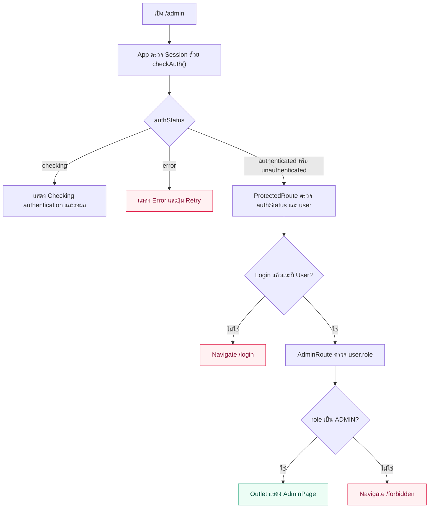
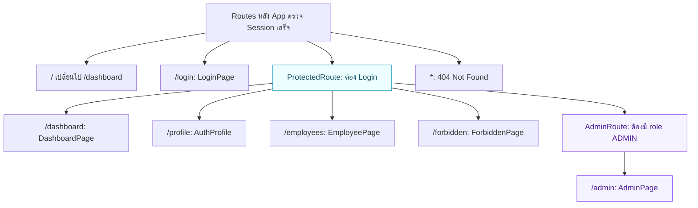
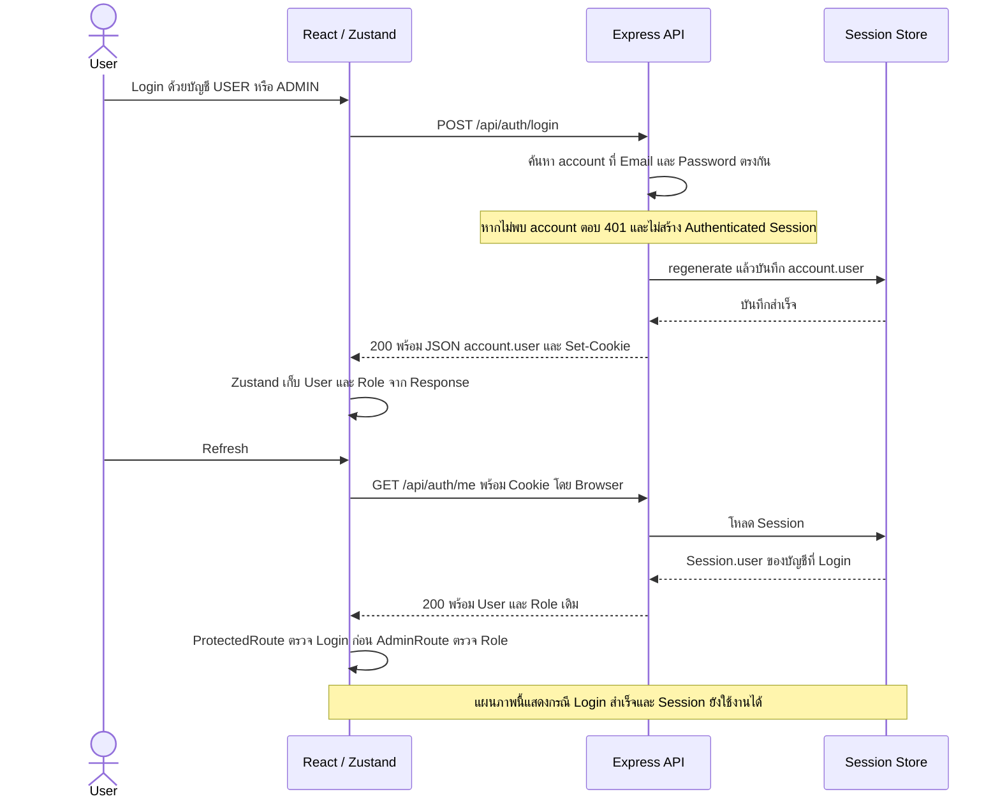

<div align="center">

  # Workshop 07.3.2: Role-based Routes

  แยกสิทธิ์ USER และ ADMIN ด้วย React Router  
  และ Role จาก Zustand Authentication Store

  
  
  

  [← Workshop 07.3.1](../workshop07-03a-protect_route/README.md) · [หน้าหลัก](../../../README.md) · [React Router Docs](https://reactrouter.com/start/declarative/routing)


</div>

---

## เกี่ยวกับ Workshop

ใน Workshop 07.3.1 เราสร้าง `ProtectedRoute` เพื่อให้ผู้ใช้ที่ Login แล้วเข้าถึง `/dashboard`, `/profile` และ `/employees` ได้ บทนี้จะเพิ่มคำถามอีกระดับหนึ่ง: **ผู้ใช้ที่ Login แล้วมีสิทธิ์เข้าหน้านั้นหรือไม่?**

USER สามารถใช้หน้าทั่วไปได้ ส่วนหน้า Admin Management จะเปิดให้ ADMIN เท่านั้น โดยใช้ `AdminRoute` ซ้อนอยู่ภายใน `ProtectedRoute`

Workshop 07.3 แบ่งเป็นสี่ช่วง:

| Workshop | หัวข้อ | สิ่งที่จะฝึก |
| --- | --- | --- |
| **07.3.1** | Protected Routes | ตรวจ Authentication ก่อนแสดง Page |
| **07.3.2 ← บทนี้** | Role-based Routes | แยกสิทธิ์ USER และ ADMIN |
| **07.3.3** | Navigation & Redirect | กลับไป URL ที่ต้องการหลัง Login |
| **07.3.4** | Backend Authorization | ตรวจสิทธิ์ใน API ด้วย Express Middleware |

เราจะใช้ `BrowserRouter`, Authentication Store และ Session APIs จากบทก่อนหน้า ไม่ต้องติดตั้ง Library เพิ่ม

## เป้าหมายการเรียนรู้

เมื่อจบ Workshop นี้ คุณจะสามารถ:

- แยกความหมายของ Authentication และ Authorization ได้
- สร้าง `AdminRoute` ที่อนุญาตเฉพาะ ADMIN ได้
- แสดง Forbidden Page เมื่อผู้ใช้ Login แล้วแต่ไม่มีสิทธิ์ได้
- ใช้ Nested Routes ซ้อน Guard สองชั้นได้
- เพิ่มบัญชีทดสอบ USER/ADMIN ใน Backend ได้
- ทำให้ Role ใน Login Response และ Session ตรงกันได้
- แสดงเมนูตาม Role โดยยังมี Route Guard ตรวจสิทธิ์ได้
- อธิบายขอบเขตของ Frontend Guard และ Backend Authorization ได้

## สารบัญ

1. [Authentication กับ Authorization](#1-authentication-กับ-authorization)
2. [สร้าง AdminRoute](#2-สร้าง-adminroute)
3. [สร้าง ForbiddenPage และ AdminPage](#3-สร้าง-forbiddenpage-และ-adminpage)
4. [ประกอบ Nested Routes](#4-ประกอบ-nested-routes)
5. [เพิ่มบัญชี ADMIN สำหรับทดสอบ](#5-เพิ่มบัญชี-admin-สำหรับทดสอบ)
6. [แสดงเมนูตาม Role](#6-แสดงเมนูตาม-role)
7. [Frontend Guard และ Backend Authorization](#7-frontend-guard-และ-backend-authorization)
8. [ทดสอบ Role-based Routes](#8-ทดสอบ-role-based-routes)
9. [Workshop Challenge](#9-workshop-challenge)
10. [คำถามทบทวน](#10-คำถามทบทวน)
11. [สิ่งที่ต้องส่งก่อนขึ้น Workshop 07.3.3](#สิ่งที่ต้องส่งก่อนขึ้น-workshop-0733)

---

## 1. Authentication กับ Authorization

| แนวคิด | คำถาม | ตัวอย่าง |
| --- | --- | --- |
| Authentication (AuthN) | ผู้ใช้เป็นใคร? | ตรวจ Email, Password และ Session |
| Authorization (AuthZ) | ผู้ใช้มีสิทธิ์ทำอะไร? | ตรวจ Role ก่อนเปิดหน้า Admin |

สำหรับ Employee Management ในบทนี้:

| ผู้ใช้ | Dashboard | Profile | Employees | Admin |
| --- | :---: | :---: | :---: | :---: |
| Guest | ❌ | ❌ | ❌ | ❌ |
| USER | ✅ | ✅ | ✅ | ❌ |
| ADMIN | ✅ | ✅ | ✅ | ✅ |

ผลลัพธ์การเปิด `/admin` หลังตรวจ Session เสร็จ:

| ผู้ใช้ | ผลลัพธ์ |
| --- | --- |
| Guest | Redirect ไป `/login` |
| USER | Redirect ไป `/forbidden` |
| ADMIN | แสดง `AdminPage` |



เมื่อพูดถึง HTTP ในระบบนี้ เราจะแยกสองกรณี:

- `401 Unauthorized` — Request ไม่มี Authentication ที่ถูกต้อง
- `403 Forbidden` — ผู้ใช้ยืนยันตัวตนแล้ว แต่ไม่มีสิทธิ์เข้าถึง Resource

ดูรายละเอียดที่ [MDN: 401](https://developer.mozilla.org/en-US/docs/Web/HTTP/Reference/Status/401) และ [MDN: 403](https://developer.mozilla.org/en-US/docs/Web/HTTP/Reference/Status/403)

## 2. สร้าง AdminRoute

### ทำไมแยกจาก ProtectedRoute?

`ProtectedRoute` ตรวจว่า Login แล้วหรือยัง หากใส่เงื่อนไข ADMIN ลงใน Guard เดิม ทุกหน้าภายในอาจกลายเป็นหน้าที่เฉพาะ ADMIN เข้าได้

เราจึงแบ่งหน้าที่:

| Guard | หน้าที่ |
| --- | --- |
| `ProtectedRoute` | ตรวจ `authStatus` และ `user` ก่อนให้เข้าหน้าสำหรับสมาชิก |
| `AdminRoute` | ตรวจว่า `user.role` เป็น `ADMIN` ก่อนให้เข้าหน้าผู้ดูแล |

สร้าง `src/routes/AdminRoute.tsx`:

```tsx
import { Navigate, Outlet } from "react-router";
import { useAuthStore } from "../stores/useAuthStore";

const AdminRoute = () => {
  const user = useAuthStore((state) => state.user);

  if (user?.role !== "ADMIN") {
    return <Navigate to="/forbidden" replace />;
  }

  return <Outlet />;
};

export default AdminRoute;
```

### อ่าน Role จาก User เดิม

เราใช้ `AuthUser` ที่มีอยู่แล้ว:

```ts
interface AuthUser {
  id: string;
  displayName: string;
  email: string;
  role: "USER" | "ADMIN";
}
```

`user?.role` ใช้ Optional Chaining เพราะ `user` อาจเป็น `null` ได้ การตรวจ `!== "ADMIN"` ทำให้ Guard อนุญาตเฉพาะ ADMIN และปฏิเสธค่าอื่นทั้งหมด

| ค่าเมื่อเข้า AdminRoute | user?.role | ผลลัพธ์ |
| --- | --- | --- |
| `null` | `undefined` | Redirect ไป Forbidden |
| USER | `"USER"` | Redirect ไป Forbidden |
| ADMIN | `"ADMIN"` | แสดง Child Route ผ่าน Outlet |

> [!NOTE]
> ตารางนี้อธิบาย AdminRoute เมื่อพิจารณาแยกตัว ในโครงสร้างจริง Guest จะถูก ProtectedRoute ส่งไป `/login` ก่อน จึงไม่ถึง AdminRoute

`<Outlet />` เป็นตำแหน่งแสดง Child Route ที่ตรงกับ URL ส่วน `replace` ใช้แทนที่ History Entry ของ URL ที่ถูกปฏิเสธ

## 3. สร้าง ForbiddenPage และ AdminPage

### 3.1 ForbiddenPage

สร้าง `src/pages/ForbiddenPage.tsx`:

```tsx
import { Link } from "react-router";

const ForbiddenPage = () => {
  return (
    <main>
      <h1>403 Forbidden</h1>
      <p>You do not have permission to access this page.</p>
      <Link to="/dashboard">Back to Dashboard</Link>
    </main>
  );
};

export default ForbiddenPage;
```

USER ที่ Login แล้วควรเห็นหน้า Forbidden เพราะมี Authentication ที่ถูกต้อง แต่ไม่มีสิทธิ์ ADMIN การส่งไป Login ใหม่จะไม่แก้ปัญหาสิทธิ์นี้

> [!IMPORTANT]
> ข้อความ “403 Forbidden” บน React Page เป็น UI ไม่ได้เปลี่ยน HTTP Status ของ SPA Document ให้เป็น 403 จริง Backend API ที่ตรวจสิทธิ์จึงต้องตอบ Status ที่เหมาะสมด้วย

### 3.2 AdminPage

สร้าง `src/pages/AdminPage.tsx`:

```tsx
import { Link } from "react-router";
import { useAuthStore } from "../stores/useAuthStore";

const AdminPage = () => {
  const user = useAuthStore((state) => state.user);

  return (
    <main>
      <h1>Admin Management</h1>
      <p>Welcome, {user?.displayName}</p>
      <p>Role: {user?.role}</p>
      <Link to="/dashboard">Back to Dashboard</Link>
    </main>
  );
};

export default AdminPage;
```

หน้า Admin ในบทนี้ใช้ทดสอบ Route Guard ยังไม่มีข้อมูลลับหรือ Admin API

## 4. ประกอบ Nested Routes

เปิด `src/App.tsx` แล้วเพิ่ม Imports:

```tsx
import AdminRoute from "./routes/AdminRoute";
import AdminPage from "./pages/AdminPage";
import ForbiddenPage from "./pages/ForbiddenPage";
```

คง Imports ของ Pages เดิม รวมถึง `Navigate`, `Route` และ `Routes` จาก `react-router` แล้วปรับเฉพาะส่วน Routes:

```tsx
return (
  <Routes>
    <Route
      path="/"
      element={<Navigate to="/dashboard" replace />}
    />

    <Route path="/login" element={<LoginPage />} />

    <Route element={<ProtectedRoute />}>
      <Route path="/dashboard" element={<DashboardPage />} />
      <Route path="/profile" element={<AuthProfile />} />
      <Route path="/employees" element={<EmployeePage />} />
      <Route path="/forbidden" element={<ForbiddenPage />} />

      <Route element={<AdminRoute />}>
        <Route path="/admin" element={<AdminPage />} />
      </Route>
    </Route>

    <Route path="*" element={<h2>404 Not Found</h2>} />
  </Routes>
);
```

คง `useEffect()` ที่เรียก `checkAuth()` และเงื่อนไข `checking`/`error` ก่อน Render Routes ตามบท 07.3.1



เมื่อ USER เปิด `/admin` จะผ่าน ProtectedRoute แต่ไม่ผ่าน AdminRoute จึงไป `/forbidden` ส่วน ADMIN ผ่านทั้งสอง Guards และเห็น AdminPage

> [!IMPORTANT]
> วาง `/forbidden` ภายใน ProtectedRoute แต่ไว้นอก AdminRoute เพื่อให้ USER เปิดหน้าปฏิเสธสิทธิ์ได้ หากวางไว้หลัง AdminRoute จะติดเงื่อนไขเดียวกับหน้าที่ถูกปฏิเสธ

Routes ที่ไม่มี `path` ใช้จัดกลุ่มและครอบ Logic โดยไม่เพิ่ม URL Segment ดังนั้น URL ในบทนี้คือ `/admin` ไม่ใช่ `/dashboard/admin` อ่านเพิ่มเติมที่ [React Router: Layout Routes](https://reactrouter.com/start/declarative/routing#layout-routes)

## 5. เพิ่มบัญชี ADMIN สำหรับทดสอบ

Backend จาก Workshop 07.2 เริ่มจาก Demo User หนึ่งบัญชี เราจะเพิ่ม Demo Admin และเลือกบัญชีตาม Credentials โดยยังไม่ใช้ Database

### 5.1 เพิ่ม Demo Admin

เปิด `server/src/server.ts` แล้วเพิ่มถัดจาก `demoUser` เดิม:

```ts
const demoAdmin: AuthUser = {
  id: "admin001",
  displayName: "Demo Administrator",
  email: "admin@example.com",
  role: "ADMIN",
};

const demoAccounts = [
  { user: demoUser, password: "workshop123" },
  { user: demoAdmin, password: "workshop123" },
];
```

### 5.2 ปรับ Login Route

แทนที่การตรวจ Credentials ที่ผูกกับ Demo User คนเดียว โดยคงการตรวจ Type ของ Email/Password ก่อนค้นหา Account และคงลำดับ Regenerate/Save:

```ts
app.post("/api/auth/login", (req, res, next) => {
  const email: unknown = req.body?.email;
  const password: unknown = req.body?.password;

  if (typeof email !== "string" || typeof password !== "string") {
    return res.status(400).json({
      message: "Email and password must be strings",
    });
  }

  const account = demoAccounts.find(
    (item) =>
      item.user.email === email &&
      item.password === password,
  );

  if (!account) {
    return res.status(401).json({
      message: "Invalid email or password",
    });
  }

  req.session.regenerate((err) => {
    if (err) return next(err);

    req.session.user = account.user;

    req.session.save((saveErr) => {
      if (saveErr) return next(saveErr);

      return res.status(200).json({
        user: account.user,
      });
    });
  });
});
```

### ทำไมต้องใช้ account.user ทั้งใน Session และ Response?

| จุดที่ต้องเปลี่ยน | ค่าที่ใช้ | เหตุผล |
| --- | --- | --- |
| `req.session.user` | `account.user` | ให้ Session เก็บบัญชีที่ Login จริง |
| JSON Response `user` | `account.user` | ให้ Zustand ได้ User และ Role คนเดียวกัน |

หากเปลี่ยนเฉพาะ Response แต่ Session ยังเก็บ Demo USER หลัง Refresh `/api/auth/me` จะคืนคนละ User/Role กับตอน Login



### บัญชีทดสอบ

| Role | Email | Password |
| --- | --- | --- |
| USER | `demo@example.com` | `workshop123` |
| ADMIN | `admin@example.com` | `workshop123` |

> [!WARNING]
> บัญชี Hardcoded ใช้ทดลองในเครื่องเท่านั้น ระบบจริงต้องตรวจ Credentials กับฐานข้อมูลและ Password Hash

เมื่อสลับบัญชี ให้ Logout ผ่าน Backend ก่อนแล้ว Login ใหม่ หรือใช้ Browser Session แยกกัน อย่าเปลี่ยน Role ใน Zustand เพื่อใช้แทนการทดสอบบัญชีจริง

## 6. แสดงเมนูตาม Role

เพิ่มเมนู Admin ใน `src/pages/DashboardPage.tsx` โดยใช้ `user` ที่เลือกจาก Store อยู่แล้ว:

```tsx
<nav style={{ display: "flex", gap: 10 }}>
  <Link to="/dashboard">Dashboard</Link>
  <Link to="/profile">My Profile</Link>
  <Link to="/employees">Employee List</Link>

  {user?.role === "ADMIN" && (
    <Link to="/admin">Admin Management</Link>
  )}
</nav>
```

| ชั้นการตรวจ | หน้าที่ |
| --- | --- |
| Conditional Menu | แสดงตัวเลือกที่เกี่ยวข้องกับ Role |
| AdminRoute | ป้องกันการเปิดหน้า Admin ด้วย URL โดยตรง |
| Backend Authorization | ป้องกันการเรียก Admin API โดยตรง |

ผู้ใช้สามารถพิมพ์ `/admin` เองแม้ไม่เห็นเมนู จึงต้องมี AdminRoute ตรวจ Role ด้วย และทุก Protected API ยังต้องตรวจสิทธิ์ฝั่ง Server

## 7. Frontend Guard และ Backend Authorization

Role ใน Zustand เป็น Client State ที่ใช้เลือก UI ผู้ใช้ควบคุม State นี้ได้ Backend จึงต้องตรวจ Session และสิทธิ์ด้วยข้อมูลฝั่ง Server

ตัวอย่างแนวคิดสำหรับ Workshop 07.3.4:

```ts
app.get("/api/admin/employees", (req, res) => {
  const user = req.session.user;

  if (!user) {
    return res.status(401).json({
      message: "Unauthenticated",
    });
  }

  if (user.role !== "ADMIN") {
    return res.status(403).json({
      message: "Forbidden",
    });
  }

  return res.status(200).json({
    employees: [],
  });
});
```

ตัวอย่างนี้แสดงหลักการล่วงหน้า ยังไม่จำเป็นต้องเพิ่ม API นี้ในบท 07.3.2 เราจะย้ายการตรวจสิทธิ์ไปเป็น Express Middleware ในบท 07.3.4

> [!NOTE]
> Role ที่เก็บใน Session อาจเก่าหากมีการแก้สิทธิ์ระหว่าง Session ยังใช้งานอยู่ ระบบจริงต้องวางวิธีตรวจสิทธิ์ล่าสุดหรือยกเลิก Session ที่เกี่ยวข้องด้วย

## 8. ทดสอบ Role-based Routes

เปิด Backend และ Frontend จากคนละ Terminal ตามบทก่อนหน้า:

```bash
# Terminal 1 — Backend
cd server
pnpm typecheck
pnpm dev
```

```bash
# Terminal 2 — Project Root
pnpm dev
```

เข้า `http://localhost:5173` แล้วทดสอบ:

| สถานการณ์ | ผลลัพธ์ที่คาดหวัง |
| --- | --- |
| Guest เปิด `/admin` | ไป `/login` |
| USER เปิด `/dashboard` | แสดง Dashboard |
| USER เปิด `/admin` โดยตรง | ไป `/forbidden` |
| USER ดู Navigation | ไม่มีเมนู Admin |
| ADMIN เปิด `/admin` | แสดง Admin Management |
| ADMIN Refresh บน `/admin` | รอตรวจ Session แล้วแสดง Admin Page |
| ADMIN ดู Navigation | มีเมนู Admin |
| ADMIN Logout จาก `/admin` | ไป `/login` |
| Login ด้วย Password ผิด | API ตอบ `401` และแสดง Login Error |

### Checklist

- [ ] Guest ถูกส่งไป Login ก่อนตรวจ Role
- [ ] USER เข้าหน้าทั่วไปได้แต่เข้า Admin ไม่ได้
- [ ] Forbidden Page เปิดได้โดยไม่เกิด Redirect Loop
- [ ] ADMIN เข้า Admin Page และ Refresh ได้
- [ ] `/api/auth/me` คืน User/Role ตรงกับบัญชีที่ Login
- [ ] Logout แล้ว Protected Routes ใช้งานไม่ได้
- [ ] เมนู Admin แสดงเฉพาะ ADMIN

## 9. Workshop Challenge

### Challenge A — สร้าง Route สำหรับ ADMIN

สร้าง AdminRoute, AdminPage และ ForbiddenPage แล้วเพิ่ม Nested Routes ลงใน App ให้ผลลัพธ์ตรงกับตาราง Guest/USER/ADMIN ในบทนี้

### Challenge B — ซ่อนเมนู ADMIN

แสดงเมนู Admin Management เฉพาะ ADMIN แล้วทดสอบ USER ด้วยการพิมพ์ URL `/admin` โดยตรงด้วย

<details>
<summary><strong>เปิดคำใบ้</strong></summary>

ใช้ `user?.role === "ADMIN"` กับ Conditional Rendering สำหรับเมนู และใช้ AdminRoute ควบคู่กันเพื่อป้องกันการเข้าผ่าน URL

</details>

### Challenge C — ออกแบบ RoleRoute ที่ใช้ซ้ำได้

โจทย์เสริม: สร้าง Guard ที่รับ Role ที่อนุญาตผ่าน Props เพื่อใช้กับหน้าที่ USER และ ADMIN เปิดร่วมกันได้:

```tsx
<RoleRoute allowedRoles={["ADMIN", "USER"]} />
```

<details>
<summary><strong>เปิดคำใบ้</strong></summary>

กำหนด Props จาก Role ของ AuthUser:

```ts
interface RoleRouteProps {
  allowedRoles: AuthUser["role"][];
}
```

ใช้ `allowedRoles.includes(user.role)` หลังตรวจว่ามี User แล้ว หาก Role ไม่อยู่ในรายการให้ไป Forbidden และเมื่อผ่านให้คืน Outlet โดยวาง Guard นี้ภายใน ProtectedRoute เช่นเดียวกับ AdminRoute

</details>

### ภารกิจที่ต้องทำ

- [ ] สร้าง AdminRoute, AdminPage และ ForbiddenPage
- [ ] ซ้อน AdminRoute ภายใน ProtectedRoute
- [ ] วาง ForbiddenPage นอก AdminRoute
- [ ] เพิ่ม Demo Admin และปรับ Login Route
- [ ] ใช้ `account.user` ทั้งใน Session และ Login Response
- [ ] แสดงเมนูตาม Role
- [ ] ทดสอบ Guest, USER, ADMIN และ Refresh
- [ ] โจทย์เสริม: สร้าง RoleRoute ที่รับ allowedRoles

## 10. คำถามทบทวน

### 1. ProtectedRoute และ AdminRoute ต่างกันอย่างไร?

- A. ProtectedRoute ตรวจ Login ส่วน AdminRoute ตรวจ Role
- B. ทั้งสองมีหน้าที่เหมือนกัน
- C. AdminRoute ใช้ส่ง Cookie ไป Backend

<details>
<summary><strong>ดูคำตอบ</strong></summary>

**คำตอบ: A** — Guard สองชั้นแยก Authentication ออกจาก Role Check ทำให้หน้าสมาชิกทั่วไปยังเปิดให้ USER ได้

</details>

### 2. ทำไม USER ที่ Login แล้วควรเห็น Forbidden แทน LoginForm เมื่อเปิด Admin?

- A. เพราะ Session หมดอายุ
- B. เพราะยังไม่มี Authentication
- C. เพราะยืนยันตัวตนแล้ว แต่ไม่มีสิทธิ์ ADMIN

<details>
<summary><strong>ดูคำตอบ</strong></summary>

**คำตอบ: C** — Login ใหม่ด้วยบัญชี USER เดิมไม่ได้ทำให้มีสิทธิ์ ADMIN จึงควรแสดงสาเหตุเรื่องสิทธิ์ให้ตรงกับสถานการณ์

</details>

### 3. หากแก้ user.role ใน Zustand เป็น ADMIN จะทำให้ใช้ Backend Admin API ได้หรือไม่?

- A. ได้ เพราะ Zustand ควบคุมสิทธิ์ทั้งหมด
- B. ไม่ได้ Backend ต้องตรวจ Session และ Role เอง
- C. ได้ หากใช้ TypeScript

<details>
<summary><strong>ดูคำตอบ</strong></summary>

**คำตอบ: B** — Client State ไม่ใช่หลักฐานยืนยันสิทธิ์ Backend ต้องตัดสินใจจาก Session และข้อมูลสิทธิ์ที่เชื่อถือได้

</details>

## สิ่งที่ต้องส่งก่อนขึ้น Workshop 07.3.3

1. `AdminRoute.tsx` — ตรวจ Role และแสดง Outlet
2. `AdminPage.tsx` และ `ForbiddenPage.tsx`
3. `App.tsx` — โครงสร้าง Nested Guards
4. `DashboardPage.tsx` — Navigation ตาม Role
5. ส่วน Login Route ใน `server/src/server.ts` ที่รองรับ ADMIN
6. คำตอบทบทวนและผลทดสอบ Guest/USER/ADMIN

สิ่งที่จะตรวจ:

- ลำดับ ProtectedRoute → AdminRoute → AdminPage
- ตำแหน่ง Forbidden Route และการป้องกัน Redirect Loop
- Role ที่ตรงกันระหว่าง Login Response กับ Session
- การ Restore Role หลัง Refresh
- การแสดงเมนูและการป้องกัน URL โดยตรง
- ความเข้าใจขอบเขต Frontend Guard กับ Backend Authorization

### ไฟล์ภาพและ Diagram

- [ภาพ Role-based Routes](../../../assets-repo/images/workshop07-03b-role-based-routes-hero.png)
- [Flowchart: Guest, USER และ ADMIN](../../../assets-repo/diagrams/workshop07-03b-role-guard-flow.mmd)
- [Diagram: Nested Routes](../../../assets-repo/diagrams/workshop07-03b-nested-route-tree.mmd)
- [Sequence Diagram: Role ใน Login และ Session](../../../assets-repo/diagrams/workshop07-03b-role-session-sequence.mmd)

Mermaid แสดงเป็นแผนภาพบน GitHub และ Markdown Viewer ที่รองรับ ส่วนไฟล์ `.mmd` เก็บต้นฉบับสำหรับแก้ไขหรือ Export ต่อไว้ใน `assets-repo`

## เตรียมพร้อมสำหรับ Workshop ถัดไป

Workshop 07.3.3 จะทำให้ผู้ใช้ที่เปิด `/employees` ก่อน Login กลับไปยัง URL นั้นหลัง Login สำเร็จ แทนการถูกส่งไป Dashboard ทุกครั้ง

## แหล่งข้อมูลเพิ่มเติม

- [React Router: Nested Routes และ Layout Routes](https://reactrouter.com/start/declarative/routing)
- [React Router: Navigate](https://reactrouter.com/api/components/Navigate)
- [React Router: Outlet](https://reactrouter.com/api/components/Outlet)
- [MDN: 401 Unauthorized](https://developer.mozilla.org/en-US/docs/Web/HTTP/Reference/Status/401)
- [MDN: 403 Forbidden](https://developer.mozilla.org/en-US/docs/Web/HTTP/Reference/Status/403)
- [OWASP: Authorization Cheat Sheet](https://cheatsheetseries.owasp.org/cheatsheets/Authorization_Cheat_Sheet.html)

---

<div align="center">

  **ถัดไป:** Workshop 07.3.3 — Navigation & Redirect

  [← Workshop 07.3.1](../workshop07-03a-protect_route/README.md) · [กลับสู่หน้าหลัก](../../../README.md)

</div>
